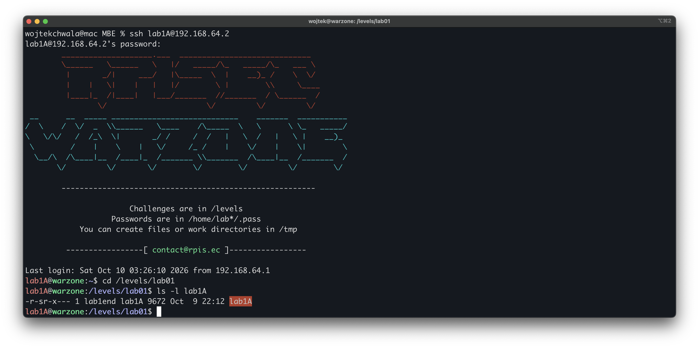
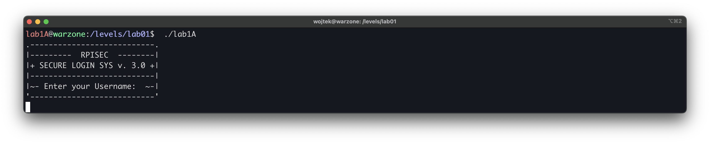
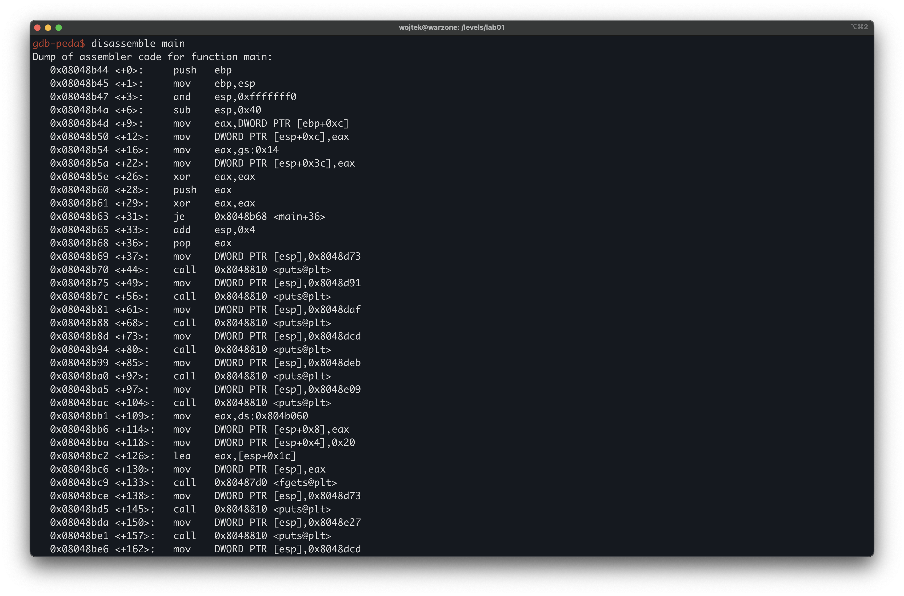
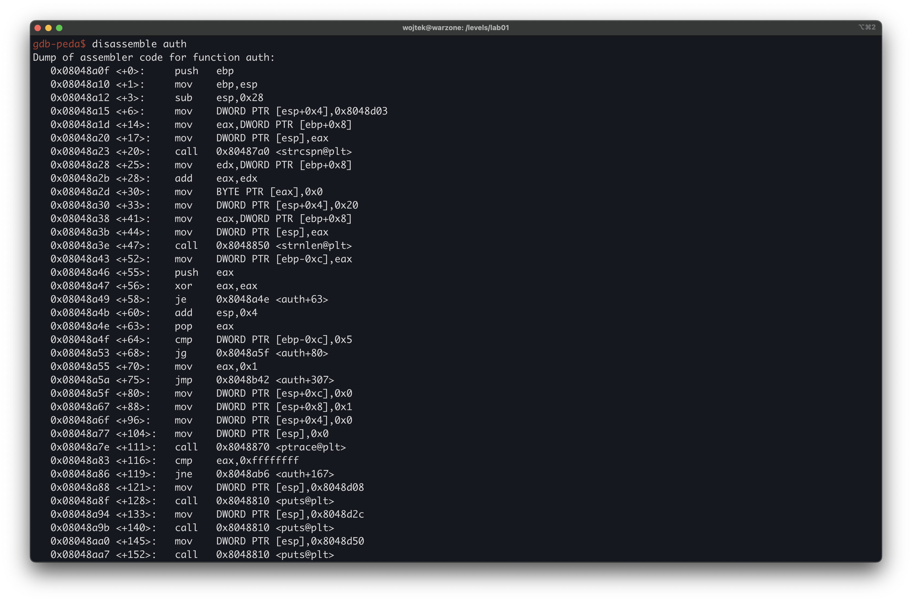
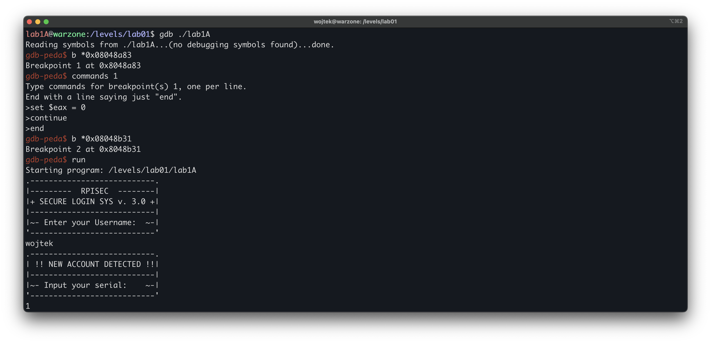
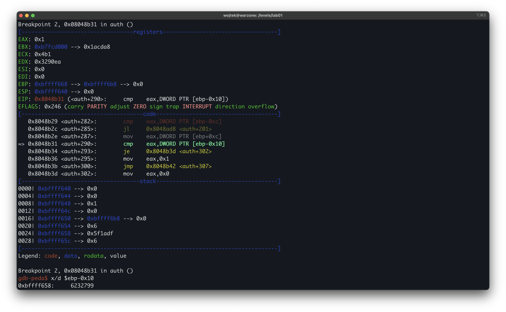
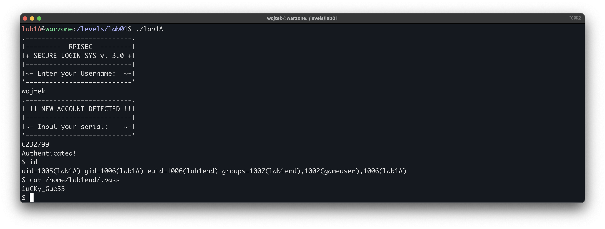

# Modern Binary Exploitation - lab1A
 
| | |
| --- | --- |
| **Tier** | A (hardest) |
| **Target** | `/levels/lab01/lab1A` |
| **Class** | username-derived serial check + `ptrace` anti-debug |
| **Goal** | recover a valid serial and escalate |

 ## Overview
 
One or two sentences: the serial is derived from the username by a checksum, and an anti-debug check guards the routine. We defeat the anti-debug, read the checksum the program computes, and feed it back as the serial.

## First look
 
Logged in as `lab1A` (via the password recovered from lab1B), read the permissions of the final lab01 target:



As with the earlier tiers, the setuid bit is set and the owner is the next user up, `lab1end`. Running the binary executes as `lab1end`, so beating it yields a shell as `lab1end` and read access to `lab1end`'s `.pass`, which is the lab01 completion flag.

Run it blind to see the surface. It prints a login banner, reads a username, then a serial:



## Disassembling `main`

`main` reads a username (fgets) and a serial (scanf %u), then calls auth(username, serial); a zero return authenticates and runs `system("/bin/sh")`.



```asm
0x08048bba <+118>: mov    DWORD PTR [esp+0x4],0x20       ; fgets size = 32
0x08048bc2 <+126>: lea    eax,[esp+0x1c]                 ; username buffer
0x08048bc6 <+130>: mov    DWORD PTR [esp],eax
0x08048bc9 <+133>: call   0x80487d0 <fgets@plt>          ; fgets(username, 32, stdin)
...
0x08048c12 <+206>: mov    DWORD PTR [esp],0x8048d00      ; scanf format
0x08048c19 <+213>: call   0x8048860 <__isoc99_scanf@plt> ; scanf("%u", &serial)
0x08048c1e <+218>: mov    eax,DWORD PTR [esp+0x18]       ; eax = serial
0x08048c22 <+222>: mov    DWORD PTR [esp+0x4],eax        ; auth arg2 = serial
0x08048c26 <+226>: lea    eax,[esp+0x1c]                 ; auth arg1 = username
0x08048c2a <+230>: mov    DWORD PTR [esp],eax
0x08048c2d <+233>: call   0x8048a0f <auth>              ; auth(username, serial)
0x08048c32 <+238>: test   eax,eax                        ; auth == 0 ?
0x08048c34 <+240>: jne    0x8048c55 <main+273>           ; nonzero -> fail (exit 1)
0x08048c36 <+242>: mov    DWORD PTR [esp],0x8048e63       ; "Authenticated!"
0x08048c3d <+249>: call   0x8048810 <puts@plt>
0x08048c42 <+254>: mov    DWORD PTR [esp],0x8048e72       ; "/bin/sh"
0x08048c49 <+261>: call   0x8048820 <system@plt>         ; win
```

The win condition is `auth` returning **0**. A zero return falls through to `system("/bin/sh")`; any nonzero value jumps to the failure exit. So everything hinges on what makes `auth` return 0. We follow it.

## Disassembling `auth`

`auth` is where the real work is. It does four things in order: normalise the username, enforce a minimum length, run an anti-debug check, then compute a checksum from the username and compare it to the serial.



**Length gate.** The username's newline is trimmed (`strcspn` on `"\n"`), its length is taken with `strnlen`, and anything shorter than 6 is rejected:

```asm
0x08048a4f <+64>:  cmp    DWORD PTR [ebp-0xc],0x5       ; len > 5 ?
0x08048a53 <+68>:  jg     0x8048a5f <auth+80>
0x08048a55 <+70>:  mov    eax,0x1                        ; len <= 5 -> return 1 (fail)
0x08048a5a <+75>:  jmp    0x8048b42 <auth+307>
```

**Anti-debug.** Next it calls `ptrace(PTRACE_TRACEME, 0, 1, 0)`. A process can only be traced by one tracer at a time, so if it is already running under a debugger this call returns `-1`, and `auth` prints "TAMPERING DETECTED" and rejects:

```asm
0x08048a77 <+104>: mov    DWORD PTR [esp],0x0            ; PTRACE_TRACEME
0x08048a7e <+111>: call   0x8048870 <ptrace@plt>
0x08048a83 <+116>: cmp    eax,0xffffffff                ; ptrace returned -1 ?
0x08048a86 <+119>: jne    0x8048ab6 <auth+167>          ; not traced -> continue
0x08048aac <+157>: mov    eax,0x1                        ; traced -> return 1 (fail)
```

**Checksum.** If the anti-debug passes, it seeds a checksum from the 4th username byte and folds every byte into it:

```asm
0x08048ab6 <+167>: mov    eax,DWORD PTR [ebp+0x8]       ; username
0x08048ab9 <+170>: add    eax,0x3                        ; &username[3]
0x08048abc <+173>: movzx  eax,BYTE PTR [eax]             ; username[3]
0x08048ac2 <+179>: xor    eax,0x1337                     ; ^ 0x1337
0x08048ac7 <+184>: add    eax,0x5eeded                   ; + 0x5EEDED  -> chk seed
0x08048acc <+189>: mov    DWORD PTR [ebp-0x10],eax       ; chk at ebp-0x10
...                                                       ; loop body (per byte):
0x08048afc <+237>: xor    eax,DWORD PTR [ebp-0x10]       ; username[i] ^ chk
0x08048b01 <+242>: mov    edx,0x88233b2b                 ; magic multiplier
0x08048b08 <+249>: mul    edx                            ; the compiler's "/ 1337"
0x08048b15 <+262>: imul   eax,eax,0x539                  ; * 1337  (0x539)
0x08048b1b <+268>: sub    ecx,eax                        ; remainder = x - (x/1337)*1337
0x08048b1f <+272>: add    DWORD PTR [ebp-0x10],eax       ; chk += (username[i] ^ chk) % 1337
0x08048b22 <+275>: add    DWORD PTR [ebp-0x14],0x1       ; i++
0x08048b29 <+282>: cmp    eax,DWORD PTR [ebp-0xc]        ; i < len ?
0x08048b2c <+285>: jl     0x8048ad8 <auth+201>
```

**The compare.** Finally the accumulated checksum is compared to the serial we typed. Equal returns 0 (authenticated); anything else returns 1:
 
```asm
0x08048b2e <+287>: mov    eax,DWORD PTR [ebp+0xc]        ; serial (our input)
0x08048b31 <+290>: cmp    eax,DWORD PTR [ebp-0x10]       ; serial == chk ?
0x08048b34 <+293>: je     0x8048b3d <auth+302>
0x08048b36 <+295>: mov    eax,0x1                        ; mismatch -> return 1
0x08048b3d <+302>: mov    eax,0x0                        ; match -> return 0 (win)
```

The two chunks of magic arithmetic (`mul 0x88233b2b` then `shr`, and `imul ...,0x539`) are the compiler's constant-division trick: multiply by a magic number, shift, and subtract to compute `x % 1337` without a `div`. `0x539` is `1337`, which is the tell.

## Analysis
 
The serial is not stored anywhere. It is computed from the username at runtime: seed `chk = (username[3] ^ 0x1337) + 0x5EEDED`, then for each byte `chk += (username[i] ^ chk) % 1337`. A valid serial is whatever `chk` ends up being for the username you supply. There are two ways to get it.

**The static route (keygen).** Reimplement the checksum in Python and compute the serial offline for any username. This is faithful to the algorithm, but it also means porting the exact unsigned arithmetic and the magic-division semantics correctly.

**The dynamic route (let the program compute it).** The binary already computes the correct `chk` for our username. If we can read `chk` out of memory at the moment of the compare, we do not need to reimplement anything. The only obstacle is the `ptrace` anti-debug, which is trivially defeated from inside the debugger by overwriting `ptrace`'s return value.

We take the dynamic route.

## Exploitation

Two breakpoints. The first sits just after the `ptrace` call and forces its return value to 0, so the `-1` tamper path is never taken. The second sits at the `serial == chk` compare, where we read the computed checksum:



At the first prompt we enter a username (here wojtek, which satisfies len >= 6) and any placeholder serial. Execution stops at the second breakpoint, and chk is the dword at ebp-0x10:



So for username `wojtek` the valid serial is `6232799`. Running the binary normally (no debugger, so the anti-debug passes on its own) and entering that pair authenticates and drops a shell as lab1end:



Flag: `1uCKy_Gue55`
