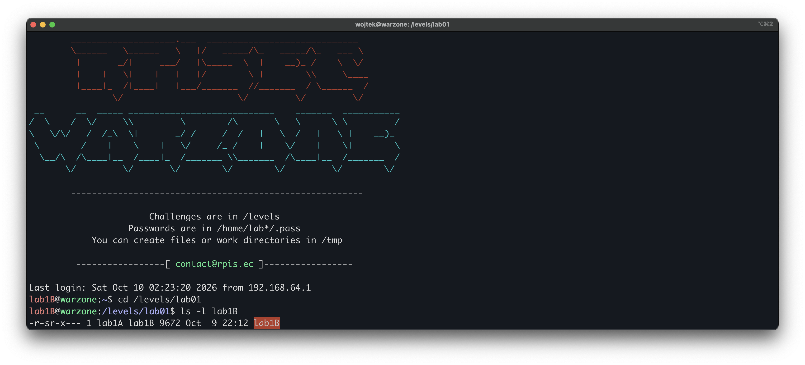
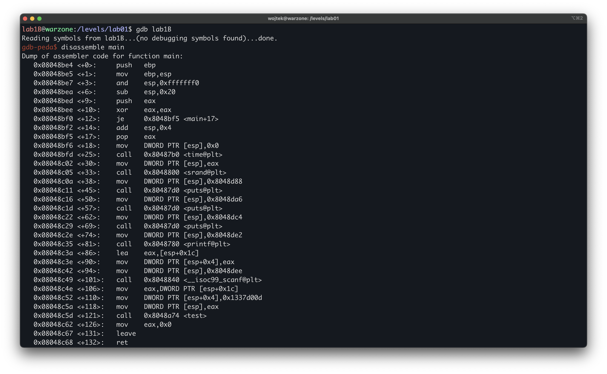
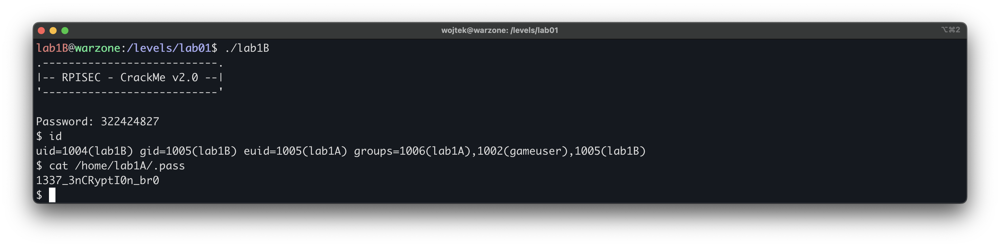

# Modern Binary Exploitation - lab1B

| | |
| --- | --- |
| **Tier** | B |
| **Target** | `/levels/lab01/lab1B` |
| **Class** | reversible obfuscation (XOR "encryption") |
| **Goal** | recover the password for `lab1A` and escalate |

## Overview

In this challenge the password is not stored in the binary but derived from one. Our input is subtracted from a hardcoded secret to produce a key, and that key is used to XOR-decrypt an embedded string. The win branch fires only when the decrypted string equals "Congratulations!". Because XOR is reversible and both the ciphertext and the target plaintext are in the binary, we recover the key from a single byte, work backward to the required input, and escalate to lab1A.

## First look

Logged in as `lab1B` (via the password recovered from lab1C), read the permissions of the next target:



As with lab1C, the setuid bit is set and the owner is the next user up, `lab1A`. Running the binary therefore executes as `lab1A`, so beating it yields a shell as `lab1A` and read access to `lab1A`'s `.pass`.

Run it blind to see the surface. Like lab1C, it prints a banner and asks for a password, reading a single value from us:
```
$ ./lab1B
.---------------------------.
|-- RPISEC - CrackMe v2.0 --|
'---------------------------'

Password:
```

## Disassembling `main`

We load the binary in GDB and disassemble main. Unlike `lab1C`, the logic does not stay in one function. `main` only reads our input and hands it off, so we follow the calls it makes into `test` and then `decrypt`, where the real check lives.



The relevant block (Intel syntax):

```asm
0x08048bfd <+25>:  call   time@plt            ; time(NULL)
0x08048c05 <+33>:  call   srand@plt           ; srand(time(NULL))  seeds the RNG
...                                            ; banner + "Password: " prompt (puts/printf)
0x08048c3a <+86>:  lea    eax,[esp+0x1c]       ; eax = &input
0x08048c3e <+90>:  mov    [esp+0x4],eax        ; scanf arg2 = &input
0x08048c42 <+94>:  mov    [esp],0x8048dee      ; scanf arg1 = format string ptr
0x08048c49 <+101>: call   __isoc99_scanf       ; scanf("%d", &input)
0x08048c4e <+106>: mov    eax,[esp+0x1c]       ; eax = input
0x08048c52 <+110>: mov    [esp+0x4],0x1337d00d ; test arg2 = secret
0x08048c5a <+118>: mov    [esp],eax            ; test arg1 = input
0x08048c5d <+121>: call   test                 ; test(input, 0x1337d00d)
```

`main` reads one integer and calls `test(input, 0x1337d00d)`. The `0x1337d00d` is a hardcoded secret, and the `srand(time(NULL))` at the top is a hint that one path through `test` uses `rand()`. No check happens here, so we follow the call into `test`.

Before that, the format string pointer passed to scanf confirms the input is read as a decimal integer:
```asm
gdb-peda$ x/s 0x8048dee
0x8048dee:	"%d"
```

## Disassembling `test`

`main` handed our input and the secret `0x1337d00d` to `test`. Disassembling it shows what the program does with them: it computes a value from the two and uses that value to select a branch.


`test` computes `res = secret - input` and runs it through a jump table:

```asm
0x08048a7a <+6>:   mov    eax,DWORD PTR [ebp+0x8]       ; eax = input
0x08048a7d <+9>:   mov    edx,DWORD PTR [ebp+0xc]       ; edx = secret (0x1337d00d)
0x08048a80 <+12>:  sub    edx,eax                       ; edx = secret - input
0x08048a82 <+14>:  mov    eax,edx                       ; eax = res
0x08048a84 <+16>:  mov    DWORD PTR [ebp-0xc],eax       ; res stored at ebp-0xc
0x08048a87 <+19>:  cmp    DWORD PTR [ebp-0xc],0x15      ; res > 21 ?
0x08048a8b <+23>:  ja     0x8048bd5 <test+353>          ; unsigned above -> default
0x08048a91 <+29>:  mov    eax,DWORD PTR [ebp-0xc]
0x08048a94 <+32>:  shl    eax,0x2                       ; res * 4
0x08048a97 <+35>:  add    eax,0x8048d30                 ; + jump-table base
0x08048a9c <+40>:  mov    eax,DWORD PTR [eax]           ; table[res]
0x08048a9e <+42>:  jmp    eax                           ; dispatch
```

This is a compiler-generated `switch`. The flow is:
 
1. `res` is compared against `0x15`. The `ja` is unsigned, so any `res` above `0x15` jumps straight to the default.
2. Otherwise `res` is multiplied by 4 (`shl eax,0x2`) and used as an offset into the jump table at `0x8048d30`.
3. Execution jumps to the case address stored there.

Every in-range case does the same thing: `decrypt(res)`. The default path does something different:

```asm
0x08048bd5 <+353>: call   0x8048830 <rand@plt>          ; default: decrypt(rand())
0x08048bda <+358>: mov    DWORD PTR [esp],eax
0x08048bdd <+361>: call   0x80489b7 <decrypt>
```

The default calls `decrypt(rand())`, a random key that will not decrypt correctly (this is why `main` seeded the RNG). So the task reduces to making `res` a value inside the table's range that is also the correct decryption key. `res` is the key passed straight to `decrypt`.

## Disassembling `decrypt`

Both the valid cases and the default path end in a call to `decrypt`, so this is where the actual check lives. Disassembling it shows how the key is used:


`decrypt(key)` rebuilds an embedded string, XORs every byte with `key`, and compares the result to a target. First the string is laid down as four dword constants on the stack:

```asm
0x080489c8 <+17>:  mov    DWORD PTR [ebp-0x1d],0x757c7d51  ; ciphertext, as dwords
0x080489cf <+24>:  mov    DWORD PTR [ebp-0x19],0x67667360
0x080489d6 <+31>:  mov    DWORD PTR [ebp-0x15],0x7b66737e
0x080489dd <+38>:  mov    DWORD PTR [ebp-0x11],0x33617c7d
0x080489e4 <+45>:  mov    BYTE PTR [ebp-0xd],0x0           ; NUL terminator
```

Then a loop walks the string, XORing each byte with `key` (the argument at `ebp+0x8`) in place:

```asm
0x08048a08 <+81>:  lea    edx,[ebp-0x1d]                   ; edx = str
0x08048a0b <+84>:  mov    eax,DWORD PTR [ebp-0x28]         ; eax = i
0x08048a0e <+87>:  add    eax,edx                          ; &str[i]
0x08048a10 <+89>:  movzx  eax,BYTE PTR [eax]               ; str[i]
0x08048a13 <+92>:  mov    edx,eax
0x08048a15 <+94>:  mov    eax,DWORD PTR [ebp+0x8]          ; eax = key
0x08048a18 <+97>:  xor    eax,edx                          ; str[i] ^ key
0x08048a22 <+107>: mov    BYTE PTR [edx],al                ; store back into str[i]
0x08048a24 <+109>: add    DWORD PTR [ebp-0x28],0x1         ; i++
0x08048a2b <+116>: cmp    eax,DWORD PTR [ebp-0x24]         ; i < len ?
0x08048a2e <+119>: jb     0x8048a08 <decrypt+81>           ; loop
```

Finally the decrypted string is compared to a target, and a match runs the shell:

```asm
0x08048a30 <+121>: mov    DWORD PTR [esp+0x4],0x8048d03    ; strcmp target
0x08048a3e <+135>: call   0x8048770 <strcmp@plt>
0x08048a43 <+140>: test   eax,eax
0x08048a45 <+142>: jne    0x8048a55 <decrypt+158>          ; mismatch -> "Invalid Password!"
0x08048a47 <+144>: mov    DWORD PTR [esp],0x8048d14        ; "/bin/sh"
0x08048a4e <+151>: call   0x80487e0 <system@plt>           ; win
```

The four dword constants at `ebp-0x1d` are the ciphertext, laid out little-endian. Reading them back as bytes:
 
```
0x757c7d51 -> 51 7d 7c 75   Q } | u
0x67667360 -> 60 73 66 67   ` s f g
0x7b66737e -> 7e 73 66 7b   ~ s f {
0x33617c7d -> 7d 7c 61 33   } | a 3
            -> "Q}|u`sfg~sf{}|a3"
```

The strcmp target is the plaintext the decryption must produce:
 
```asm
gdb-peda$ x/s 0x8048d03
0x8048d03:	"Congratulations!"
```

## Recovering the key

XOR is symmetric: if `ciphertext[i] ^ key == plaintext[i]`, then `key == ciphertext[i] ^ plaintext[i]`. Both strings are in the binary, and the key is a single byte applied to every character, so one byte pair is enough:

```
'Q' (0x51) ^ 'C' (0x43) = 0x12 = 18
```

The key is **18**, which is below the `0x15` bound, so it dispatches through the jump table to `decrypt(18)` rather than the random default. Verifying the whole blob decrypts with 18:

```python
$ python -c 'print "".join(chr(b^18) for b in [0x51,0x7d,0x7c,0x75,0x60,0x73,0x66,0x67,0x7e,0x73,0x66,0x7b,0x7d,0x7c,0x61,0x33])'
Congratulations!
```

## Backing out the input

`res` (the key) is `secret - input`, so `input = secret - res = 0x1337d00d - 18`:

```
gdb-peda$ p/d 0x1337d00d - 18
$1 = 322424827
```

The required input is **322424827**.


 
