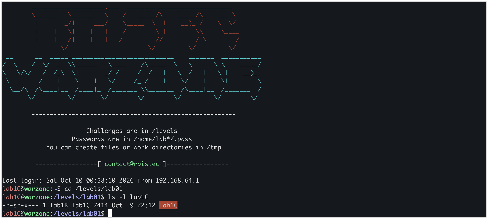
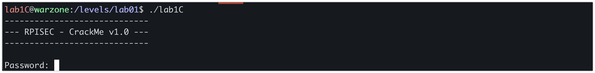
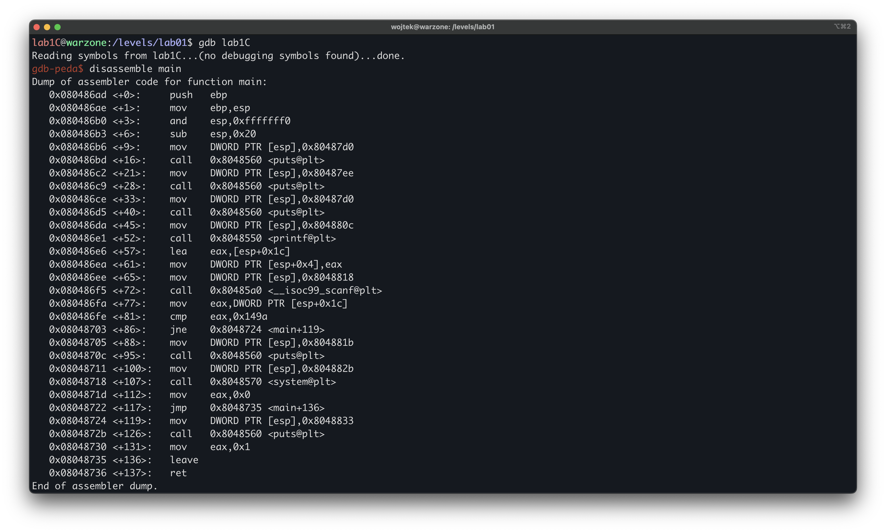

# Modern Binary Exploitation - lab1C

| | |
| --- | --- |
| **Tier** | C (entry) |
| **Target** | `/levels/lab01/lab1C` |
| **Class** | hardcoded credential / compiled-in secret |
| **Goal** | recover the password for `lab1B` and escalate |

## Overview
 
In this challenge we exploit a SUID binary that guards a privileged action behind a comparison against a value left in the code. We disassemble the binary to recover the expected value and the command it runs, supply that value to reach the privileged branch, and escalate to lab1B.

## First look
 
The target is a 32-bit x86 ELF. Before disassembling anything, the first thing to read is the **file permissions**, because they define the trust boundary - who may run the binary and whose privileges it runs with:

The permissions tell us the setuid bit is set - the s in `r-s`, where you’d normally see `r-x`. It means the binary always runs as its owner, `lab1B`, no matter who starts it. That is why solving it matters: the reversing below just finds a password, but the setuid bit is what turns that into a lab1B shell, and `lab1B`’s `.pass` unlocks the next tier.

Running it blind shows the surface: a banner, a password prompt, and a single integer input.

## Disassembling `main`
 
We load the binary in GDB and disassemble `main`. Since the program's whole logic lives in `main`, this one view gives us everything: how input is read, the check it's compared against, and what happens on success versus failure.

