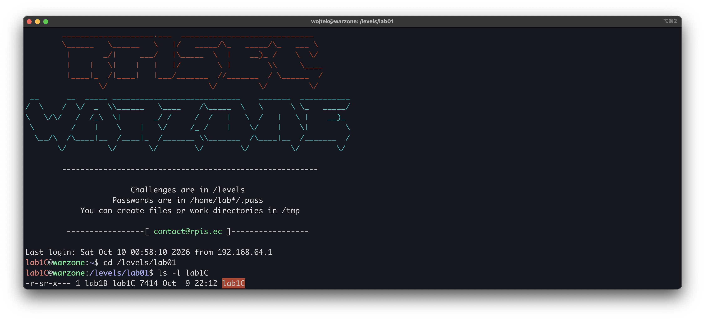
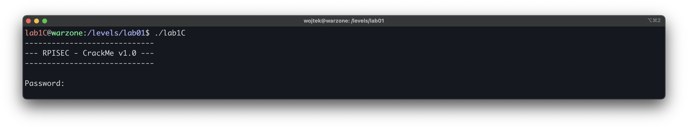
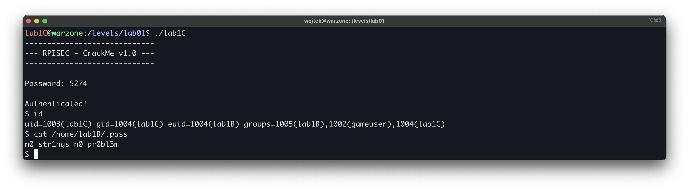

# Modern Binary Exploitation - lab1C

| | |
| --- | --- |
| **Tier** | C (entry) |
| **Target** | `/levels/lab01/lab1C` |
| **Class** | hardcoded credential / compiled-in secret |
| **Goal** | recover the password for `lab1B` and escalate |

## Overview
 
In this challenge we exploit a SUID binary that guards a privileged action behind a comparison against a value left in the code. We disassemble the binary to recover the expected value and the command it runs, supply that value to reach the privileged branch, and escalate to lab1B.

## First look
 
The target is a 32-bit x86 ELF. Before disassembling anything, the first thing to read is the **file permissions**, because they define the trust boundary - who may run the binary and whose privileges it runs with:



The permissions tell us the setuid bit is set - the s in `r-s`, where you’d normally see `r-x`. It means the binary always runs as its owner, `lab1B`, no matter who starts it. That is why solving it matters: the reversing below just finds a password, but the setuid bit is what turns that into a lab1B shell, and `lab1B`’s `.pass` unlocks the next tier.

Running it blind shows the surface: a banner, a password prompt, and a single integer input.



## Disassembling `main`
 
We load the binary in GDB and disassemble `main`. Since the program's whole logic lives in `main`, this one view gives us everything: how input is read, the check it's compared against, and what happens on success versus failure.


The relevant block (AT&T syntax):
```asm
0x080486e6 <+57>:  lea    0x1c(%esp),%eax      ; eax = &buf  (buf at esp+0x1c)
0x080486ea <+61>:  mov    %eax,0x4(%esp)       ; scanf arg2 = &buf
0x080486ee <+65>:  movl   $0x8048818,(%esp)    ; scanf arg1 = format string ptr
0x080486f5 <+72>:  call   __isoc99_scanf       ; scanf(fmt, &buf)
0x080486fa <+77>:  mov    0x1c(%esp),%eax      ; eax = buf (the value we typed)
0x080486fe <+81>:  cmp    $0x149a,%eax         ; compare against 0x149a
0x08048703 <+86>:  jne    0x8048724 <main+119> ; mismatch -> failure branch
0x08048705 <+88>:  movl   $0x804881b,(%esp)    ; "Authenticated!" (puts)
0x0804870c <+95>:  call   <puts@plt>
0x08048711 <+100>: movl   $0x804882b,(%esp)    ; system arg1 = command ptr
0x08048718 <+107>: call   <system@plt>         ; system(<cmd>)
...
0x08048724 <+119>: movl   $0x8048833,(%esp)    ; failure message (puts)
0x0804872b <+126>: call   <puts@plt>
```

The program reads one integer, compares it to `0x149a`, and if they match it calls system() on a hardcoded string. Otherwise it prints a failure message and exits.
Before the `scanf` and `system` calls, the code loads pointer values as their arguments (`0x8048818`, `0x804882b`). On 32-bit x86 (cdecl), arguments are passed on the stack, so the value placed in `(%esp)` right before a `call` is that function's first argument. That is why `0x8048818` is `scanf`'s first argument and `0x804882b` is `system`'s. What those pointers actually contain isn't in the disassembly, though, so we read them with `x/s`.


### Confirming each pointer against the binary

The scenery strings resolve to exactly that, a separator banner:

```
gdb-peda$ x/s 0x80487d0
0x80487d0:	'-' <repeats 29 times>
```

The scanf format string is the one that determines whether our input is decimal or hex:

```
gdb-peda$ x/s 0x8048818
0x8048818:	"%d"
```

`"%d"` means `scanf` parses a signed decimal integer. To match `cmp $0x149a,%eax` we enter the decimal form of `0x149a`, not the hex digits. Had the format been `"%x"`, the input would be `149a` instead. The format string, not the compare, decides the encoding.

The `system` argument is the payload of the whole level:

```
gdb-peda$ x/s 0x804882b
0x804882b:	"/bin/sh"
```

The win path runs `system("/bin/sh")`. Because the binary is SUID `lab1B`, that shell inherits `lab1B`'s privileges.

The comparison value 0x149a is written in hex, but the "%d" format means our input is read as decimal. The two are the same number in different bases, so we need the decimal form to type. p/d prints a value in decimal:

```
gdb-peda$ p/d 0x149a
$1 = 5274
```

Entering `5274` passes the check and `system("/bin/sh")` drops us into a shell. The `id` output confirms the escalation: our real UID is still `lab1C`, but the effective UID is `lab1B`. That raised euid is what lets the shell read `/home/lab1B/.pass`, a file `lab1C` has no access to.


