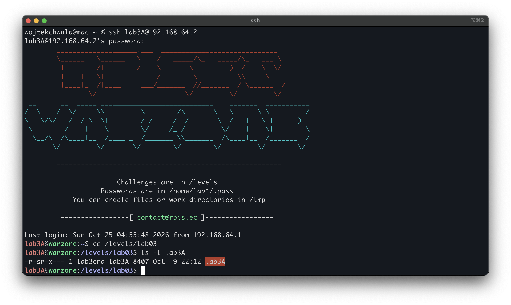
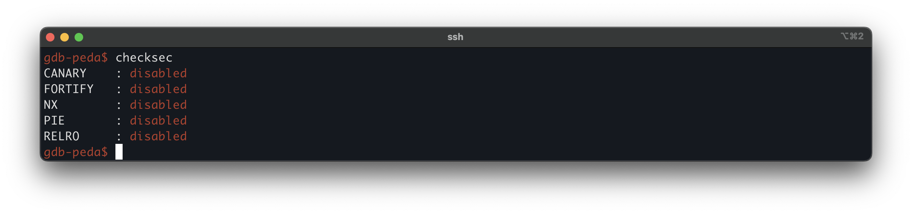
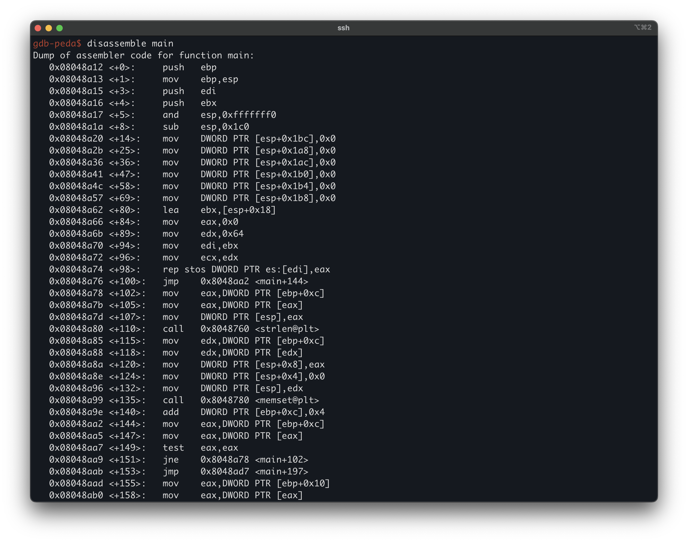

# Modern Binary Exploitation - lab3A
 
| | |
| --- | --- |
| **Lab** | 03 · Shellcoding |
| **Tier** | A |
| **Target** | `/levels/lab03/lab3A` (ELF32, Intel 80386) |
| **Class** |  |
| **Root cause** | |
| **Impact** |  |
| **Goal** | run shellcode as the setuid owner and retrieve the next `.pass` |
| **Difficulty** | |

## Overview

## First look
 
Logged in as `lab3A`, the first thing we look at is the target's permissions:
 


The `s` in the mode string `-r-sr-x---` is the `setuid` bit, and the owner is `lab3end`, so any code the program runs executes with `lab3end`'s effective `uid`. The group is `lab3A`, which is why we, logged in as `lab3A`, hold the group's `r-x` and may execute the file at all. The escalation target for this tier is therefore `lab3end`, and the file we are after is `/home/lab3end/.pass`.

We check the mitigation posture with checksec:




All protections are disabled. With `NX` off, the stack and other writable mappings are executable, so attacker-supplied bytes can be executed as code. With no `stack canary`, a sequential write from the buffer reaches the saved return address with no guard value in between, so hijacking control flow requires only the buffer-to-return offset. With `PIE` disabled, the binary loads at a fixed base, so its code and data addresses are constant across runs. With `RELRO` off, the `GOT` stays writable, and with `FORTIFY` off, the standard string functions carry no bounds-checking wrappers.

Running it blind shows the surface:

```bash
$ ./lab3A
----------------------------------------------------
  Welcome to quend's crappy number storage service!
----------------------------------------------------
 Commands:
    store - store a number into the data storage
    read  - read a number from the data storage
    quit  - exit the program
----------------------------------------------------
   quend has reserved some storage for herself :>
----------------------------------------------------

Input command: read
 Index: 1
 Number at data[1] is 0
 Completed read command successfully
```

## Disassembling `main`


