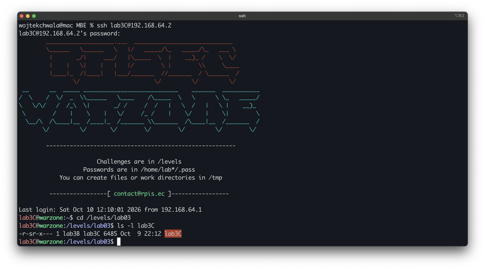
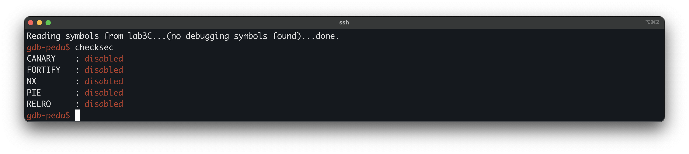
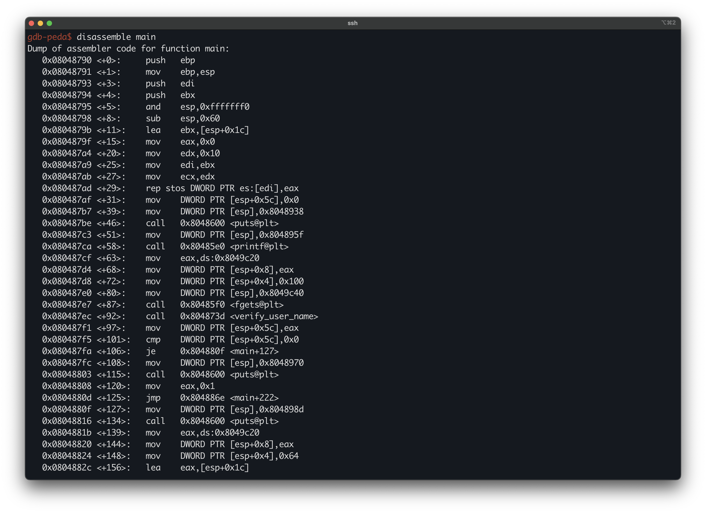

# Modern Binary Exploitation - lab3C
 
| | |
| --- | --- |
| **Lab** | 03 · Shellcoding |
| **Tier** | C (entry) |
| **Target** | `/levels/lab03/lab3C` |
| **Class** | stack buffer overflow (return-address overwrite into injected shellcode) |
| **Goal** | run injected shellcode as the setuid owner and retrieve the .pass for lab3C |


## Overview
 
lab03 is the Shellcoding lab, and this is its entry tier. lab02 forced us to reuse code already present in the binary, because NX marked the stack non-executable. lab03 clears NX, so injected bytes can run, and the task becomes supplying that code ourselves. The target is a small login program that reads a username and a password. The password read overflows a stack buffer in `main` with nothing guarding the saved return address, which hands us control of EIP. For the code itself we use the username field, which is stored at a fixed address and, with NX off, is executable, so it serves as the host for a short `execve("/bin/sh")` stub. We overwrite the saved return address with the address of that stub.
 
## First look
 
Logged in as `lab3C`, the first thing we look at is the target's permissions:
 


The s in the mode string `-r-sr-x---` is the `setuid` bit, and the owner is `lab3B`, so any code the program runs executes with `lab3B`'s effective `uid`.

Because this is the shellcoding tier, the mitigation posture is not a formality. It decides whether injected code can run at all, so we read it before anything else.



Everything is off. `NX` disabled makes the stack executable, so injected shellcode runs. `CANARY` disabled leaves nothing between the buffer and the saved return address, so the offset is just buffer-to-EIP. `PIE` disabled keeps addresses fixed, which we rely on when choosing where to jump.

Running it blind shows the surface:

```bash
$ ./lab3C
********* ADMIN LOGIN PROMPT *********
Enter Username: admin
verifying username....

nope, incorrect username...
```

## Disassembling `main`

`main` is the dispatcher. It reads a username into a global, checks it, then reads a password into a stack buffer and checks that. The relevant lines:



```asm
0x08048798 <+8>:   sub    esp,0x60                   ; reserve locals
0x0804879b <+11>:  lea    ebx,[esp+0x1c]             ; the password buffer
0x080487ad <+29>:  rep stos DWORD PTR es:[edi],eax   ; zero 16 dwords = 64 bytes at esp+0x1c

; username: read into a global, then checked
0x080487d8 <+72>:  mov    DWORD PTR [esp+0x4],0x100  ; fgets size = 256
0x080487e0 <+80>:  mov    DWORD PTR [esp],0x8049c40  ; fgets dest = the name global
0x080487e7 <+87>:  call   0x80485f0 <fgets@plt>      ; fgets(0x8049c40, 256, stdin)
0x080487ec <+92>:  call   0x804873d <verify_user_name>
0x080487f5 <+101>: cmp    DWORD PTR [esp+0x5c],0x0
0x080487fa <+106>: je     0x804880f <main+127>       ; strncmp matched -> password stage

; password: read into the stack buffer
0x08048824 <+148>: mov    DWORD PTR [esp+0x4],0x64   ; fgets size = 100
0x0804882c <+156>: lea    eax,[esp+0x1c]             ; fgets dest = the 64-byte buffer
0x08048833 <+163>: call   0x80485f0 <fgets@plt>      ; fgets(buf, 100, stdin)   -- 100 > 64
0x0804883f <+175>: call   0x804876d <verify_user_pass>

; epilogue
0x0804886e <+222>: lea    esp,[ebp-0x8]
0x08048874 <+228>: ret                                ; returns into the overwritten saved EIP
```
